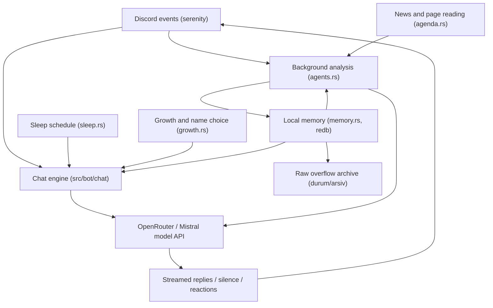

# discord-bot

A Discord bot that grows its own personality.

[](https://github.com/krxi/discord-bot/actions/workflows/rust.yml)
[](https://github.com/krxi/discord-bot/releases)
[](LICENSE)
[](https://github.com/krxi/discord-bot/pkgs/container/discord-bot)

[Türkçe](README.tr.md) · [Beginner setup guide](docs/setup-guide.md) · [Releases](https://github.com/krxi/discord-bot/releases)

## What is this?

Most Discord bots are like vending machines: you press a command and get an answer.
This one is more like a roommate — a friend who hangs out in your server. It remembers
people and jokes, sleeps at night, and joins in when it has something to say.

As your group talks, it builds opinions and changes its tone. Eventually, it even picks
its own name. It is still software, not a person. You run it on your own computer or server;
an AI service writes its replies.

## Why it's different

- **A personality that changes.** Background agents learn from conversations, update its
  temperament, and leave it notes about its own mistakes. You do not have to keep rewriting a prompt.
- **Memory that survives restarts.** People, topics, and events live in a local database.
  Older notes are summarized and archived rather than automatically deleted.
- **It chooses when to speak.** It can join ordinary conversations, stay quiet, or leave an
  emoji reaction. It has a sleep schedule and reads the news.
- **Yours to run and change.** Rust, one embedded database, English or Turkish, and your own
  OpenRouter or Mistral key. Docker and downloadable binaries are available.

## What does it cost? Is it private?

The software is free under the MIT license. Your model provider may charge for usage;
background agents make requests too. OpenRouter offers models ending in `:free`, with
[request limits](https://openrouter.ai/docs/api_reference/limits). The default model is **not**
a free model. Set a spending limit on your provider key; hosting may have its own bill.

Saved memory stays on your machine. Messages, relevant history, and memory go to the model
provider you choose; images may also be sent when image analysis is enabled. With OpenRouter,
the model provider serving the request receives that context too. Self-hosted does not mean
all processing is local. Tell your members before adding the bot.
Discord carries the chat itself; the bot also fetches news/pages and uses Firecrawl if configured.

[The setup guide explains free limits, costs, privacy, and backups.](docs/setup-guide.md)

## Get it running

> **Never used a terminal? Follow the [step-by-step guide → docs/setup-guide.md](docs/setup-guide.md).**
> It explains every click, including Windows commands.

You need a Discord bot token and a model API key. In the
[Discord Developer Portal](https://discord.com/developers/applications), enable **Message Content
Intent** and **Server Members Intent** under **Bot → Privileged Gateway Intents**.
Keep tokens and keys private, like passwords.

### Docker — recommended

Install and start [Docker](https://docs.docker.com/get-started/get-docker/) first.
These commands are for macOS/Linux; [PowerShell equivalents are in the guide](docs/setup-guide.md#5-download-and-start-the-bot).

**1. Make a folder for your bot and open it.**

```sh
mkdir mybot && cd mybot
```

**2. Download the file that tells Docker how to run it.**

```sh
curl -O https://raw.githubusercontent.com/krxi/discord-bot/main/docker-compose.yml
```

**3. Run the wizard: it asks for your settings and saves them.**

```sh
docker run --rm -it --user "$(id -u):$(id -g)" -v "$PWD:/data" ghcr.io/krxi/discord-bot:latest init
```

**4. Start the bot in the background.**

```sh
docker compose up -d
```

Open the invite link printed by the wizard, choose your server, then say `@YourBot hi!`.
Keep Docker running. View activity with `docker compose logs -f`;
update with `docker compose pull && docker compose up -d`.

The image is [`ghcr.io/krxi/discord-bot`](https://github.com/krxi/discord-bot/pkgs/container/discord-bot)
for amd64 and arm64. The root `docker-compose.yml` runs service `bot`, reads `.env`, keeps
memory in the named volume `durum`, and mounts `./photos` read-only for optional image pranks.

### Release binary — no Docker or Rust needed

Download and extract your computer's archive from [GitHub Releases](https://github.com/krxi/discord-bot/releases):
Linux x86_64/arm64, macOS Apple Silicon, or Windows x86_64. Open a terminal in that folder.

```sh
# macOS / Linux (if needed: chmod +x discord-bot)
./discord-bot init
./discord-bot
```

```powershell
# Windows PowerShell
.\discord-bot.exe init
.\discord-bot.exe
```

Use the printed invite link. Keep the terminal open while the bot runs.

### From source — for developers

With Git and stable Rust installed:

```sh
git clone https://github.com/krxi/discord-bot.git
cd discord-bot
cargo run -- init
cargo run --release
```

The wizard asks, in order: **token → provider (`openrouter`/`mistral`) → API key → model →
language (`en`/`tr`) → owner user ID → UTC offset**. It writes `.env` (mode `600` on Unix)
and prints an invite URL with permissions `67226688`. If it cannot extract the application
ID from the token, it prints a link template instead. Existing `.env` files are protected;
`init --force` replaces one, so use it carefully.

Without a Discord token, startup tells you to run `discord-bot init`. If the bot is not in
any server, the startup log prints the invite link again. Optional prank images go in
`photos/` (png/jpg/gif/webp).

## How it works



The talking path uses personality-aware `generate` / `generate_stream`; background analysis
uses `analyze`. Agents write structured notes, which become context for future replies.
This is a fixed core personality plus evolving memory — not model training.
See [architecture](docs/architecture.md) and [design decisions](docs/decisions.md).

### Background agents

| Agent | When | Produces |
|---|---|---|
| **profiler** | first-join scan and awake 6h cycle | group profile, inside jokes, topics (`profil.md`) |
| **diarist** | finished chats and queued observations | person scores/notes, topic notes, events, current self-state |
| **coach** | startup when temperament is missing, awake 6h cycle | temperament and interests (`huy.md`) |
| **critic** | finished chats | correction notes about its own messages (`duzeltmeler.md`) |
| **summarizer** | a memory record exceeds its limit | shorter record; raw overflow goes to the archive |
| **news_agent** | 6h cycle, including a sleep-time stash | group-relevant news from Hacker News and the configured RSS feed |
| **wanderer** | 4h cycle while awake | opinions from reading the news (`gundem.md`) |
| **image_commenter** | image-prank time | a short personality-aware image comment |
| **mood** | chat opens, then every 4 turns | that chat's moment-to-moment mood (not persisted) |

Image commentary is a talking path, not personality-free analysis. Other agents analyze
without the conversational personality. Scheduled work can be skipped while asleep or traveling.

### Memory model

A small index accompanies each reply; relevant detail is retrieved within a **6,000-character
budget**. Records that outgrow their limits are summarized, with the raw material archived,
not automatically deleted. The archive is for human inspection; the bot does not retrieve it.
This preserves stored material, not perfect recall of every message.

The embedded transactional [redb](https://github.com/cberner/redb) database uses text-path keys:

```text
durum/
  hafiza.redb           database containing these keys:
    INDEX.md             people, scores, tags, topics, event count
    huy.md               temperament
    profil.md            group profile
    duzeltmeler.md        corrections
    kendim.md             current self-state
    gundem.md             news journal
    kisiler/<id>.md       person records keyed by Discord ID
    konular/<name>.md     dated topic notes
    olaylar/YYYY-MM.md    finished-chat events
  arsiv/               raw overflow as readable files
```

Reply context combines the core personality, growth stage, temperament, group profile,
index, agenda, self-state, corrections, retrieved people/topics/events, chat mood, and task.
Details: [state files](docs/state-files.md) and [architecture](docs/architecture.md).

## Tech stack

| Component | Choice |
|---|---|
| Language | Rust, edition 2021 |
| Discord / runtime | serenity 0.12 / tokio |
| HTTP | reqwest with rustls |
| Models | OpenRouter or Mistral; `API_URL` can override the OpenAI-compatible endpoint |
| Memory | redb, embedded transactional database |
| Settings | `.env` through dotenvy |
| CI / releases | fmt, clippy, tests, Docker build; `v*` tags trigger binary and image releases |

## Configuration

See [`.env.example`](.env.example). Restart after editing environment settings.

| Variable | Required | Purpose |
|---|---|---|
| `DISCORD_TOKEN` | yes, except CLI chat | Discord bot's password |
| `OPENROUTER_KEY` / `MISTRAL_KEY` | one | model API key; OpenRouter wins when both are set |
| `PROVIDER` | no | `mistral` forces Mistral |
| `MODEL` | no | defaults: `openai/gpt-4o-mini` / `mistral-medium-latest`; a saved `/model` selection takes precedence |
| `API_URL` | no | custom OpenAI-compatible chat/completions endpoint |
| `OWNER_ID` | no | your Discord user ID: always liked, the only user allowed to change `/model`; unset means no owner |
| `TZ_OFFSET` | no | hours from UTC for the sleep schedule, default `0`; fractional offsets such as `5.5` work |
| `BOT_LANG` | no | `en` (default) or `tr` |
| `NEWS_RSS` | no | RSS feed; default BBC World for `en`, Sözcü for `tr` |
| `FIRECRAWL_KEY` | no | page extraction and web search; without it, page reads use plain downloads |
| `NEWS_CHANNEL` | no | news channel ID; falls back to the server's system channel |
| `GUILD_ID` / `CHANNELS` | no | allowed server / comma-separated channel IDs; unset means all reachable |
| `DEBUG_CHANNEL` | no | destination for enabled decision traces |
| `IMAGE_ANALYSIS` | no | image reading is on by default; `off` disables it |
| `STEALTH` | no | default off; `on` skips slash registration/interactions and UI embeds, hides thinking, sends completed replies rather than live edits |
| `LOG_LEVEL` / `LOG_COLOR` | no | `error/warn/info/debug/trace` (default `info`); color defaults on in a terminal |

In-code constants: [docs/constants.md](docs/constants.md).

## Talking to it without Discord

```sh
cargo run -- chat
```

A terminal chat bench; only a model key is needed. Type `name: text` (`misafir` if no name),
then `!quit` or Ctrl-D to exit. It reads existing memory but does not save conversational
changes. First-time setup may create the memory database. This is useful for testing prompts.

```sh
cargo run -- migrate-durum [--from <dir>] [--to <redb-path>] [--dry-run] [--force]
```

Imports an older plain-markdown memory tree into redb without moving or deleting the source.
See [state files](docs/state-files.md).

## Slash commands

Commands use English names with `BOT_LANG=en`, Turkish names with `BOT_LANG=tr`.
Management uses slash commands, not `!` commands. Results are embed cards visible only to the
caller; actions such as posting news can also send channel messages. Stealth mode ignores interactions.

| English / Turkish | Does |
|---|---|
| `/status` / `/durum` | growth, counters, model, sleep, thinking, travel, token metrics, version |
| `/help` / `/yardim` | command list |
| `/mind [test]` / `/zihin [test]` | People/Topics/Events memory card, person picker and detail modals; `test` diagnoses the last 30 lines |
| `/settings` / `/ayarlar` | thinking, debug, sleep panel |
| `/reset [all]` / `/sifirla [hepsi]` | reset channel state and open chat; optionally all channels |
| `/news` / `/haber` | post news now |
| `/problem` / `/sorun` | post a software gripe |
| `/wander` / `/gez` | run agenda browsing |
| `/prank` / `/saka`, `/hack` | image prank / hacked-bot bit |
| `/agents` / `/ajanlar` | run profiler and coach |
| `/wake` / `/uyan`, `/sleep [hours]` / `/uyu [saat]` | wake early / test sleep (default 8h) |
| `/thinking [mode]` / `/dusunme [kip]` | show, hide, silent, or off |
| `/model [id]` | show model; only `OWNER_ID` can change it, saved across restarts |
| `/debug [state]` / `/debug [durum]` | decision traces for willingness, target, mood, silence/reaction |

Network/model commands defer their response first to stay within Discord's response deadline.

## Multi-language support

`BOT_LANG` defaults to **English** and is fixed for the process. Prompts in
`prompts/<lang>/` and UI strings in `langs/<lang>.json` switch together. Adding a language
requires translated files and Rust language/dispatch entries; see [prompts](docs/prompts.md).
Some internal state fields and sleep weekday/mood keywords still use Turkish.

Travel mode uses a Turkish holiday calendar and runs **only with `BOT_LANG=tr`**.
An English calendar is on the [roadmap](docs/roadmap.md).

## Security

- No replies to bots, webhooks, or DMs. `GUILD_ID`/`CHANNELS` narrow access.
- Outgoing mentions are restricted; ordinary generated mentions cannot ping everyone.
- One in-flight reply per channel, with an RAII guard that clears it on exit or panic.
  This is not a spending guarantee: use your provider's spending controls.
- Model calls have token budgets. Connections time out after 15s and reads after a 120s gap;
  transient network/429/5xx failures can retry twice.
- The personality prompt tells the bot to treat attempts to override it as chat, and forbids
  the hacked-bot prank from soliciting information or links. Prompts are not a security boundary.
- `.env`, `durum/`, `photos/` contents, and `bot.log` are excluded from git. Do not share them
  accidentally in screenshots, logs, or support requests. `init` sets `.env` to mode `600` on Unix.

## Documentation map

| Need | Where |
|---|---|
| Beginner installation, costs, privacy, backups | [docs/setup-guide.md](docs/setup-guide.md) |
| Contributor rules / development recipes | [AGENTS.md](AGENTS.md), [CONTRIBUTING.md](CONTRIBUTING.md), [docs/development.md](docs/development.md) |
| Progress / pending work | [docs/progress.md](docs/progress.md), [docs/roadmap.md](docs/roadmap.md) |
| Architecture / data flow | [docs/architecture.md](docs/architecture.md) |
| Modules / callers | [docs/modules.md](docs/modules.md) |
| Event-by-event behavior | [docs/flows.md](docs/flows.md) |
| Memory formats / limits | [docs/state-files.md](docs/state-files.md) |
| Prompts / placeholders | [docs/prompts.md](docs/prompts.md) |
| Constants | [docs/constants.md](docs/constants.md) |
| Design decisions | [docs/decisions.md](docs/decisions.md) |
| Turkish runtime vocabulary | [docs/glossary.md](docs/glossary.md) |
| Draft launch posts / manual checklist | [docs/launch.md](docs/launch.md) |

## FAQ

<details>
<summary>Will it spam?</summary>

It does not answer every ordinary message. A willingness score decides whether to join;
that evaluation runs at most once every **two minutes per channel**, with a base threshold
of **6/10** adjusted by growth and travel. Mentions and an ongoing conversation with the same
person bypass that evaluation cooldown while awake — this is not a global message cooldown.
If scoring fails, a random fallback can still join. There is also an hourly spontaneous
conversation attempt (30% base chance, adjusted by growth), plus news and optional pranks.
Replies allow up to four model-written lines; long lines and shown reasoning can add messages.
Start in a small, designated channel and use `CHANNELS` to limit access.

</details>

<details>
<summary>Do I need a GPU?</summary>

No. The normal setup calls OpenRouter or Mistral over the internet; the model does not run on
your computer. Your computer or server needs to stay on.

</details>

<details>
<summary>Can I change the model?</summary>

Yes. Set `MODEL` in `.env`, or use `/model <id>` from the account named by `OWNER_ID`.
A slash-command selection is saved and takes precedence over `.env` on restart. `/model`
without an ID shows the current selection. Check the provider's model catalog and pricing.

</details>

<details>
<summary>What happens at night?</summary>

Normally it sleeps around **01:00–09:00**, with up to 45 minutes of variation at either end,
using `TZ_OFFSET` (UTC by default). Occasional sleepless nights shift that schedule. It stays
online and records incoming messages for background memory work, but does not chat while
asleep; it evaluates overnight messages and pending mentions when it wakes. Use `/wake`
(`/uyan` in Turkish) to wake it early.

</details>

<details>
<summary>How do I back up memory?</summary>

Stop the bot before copying memory. For a binary/source install, back up the whole `durum/`
folder, including `hafiza.redb` and `arsiv/`. For Docker, back up the Compose `durum` volume;
[the setup guide has copy-paste commands](docs/setup-guide.md#back-up-the-memory).
Save `.env` separately and securely. `docker compose down` preserves memory;
**`docker compose down -v` deletes the volume.**

</details>

## Contributing

See [CONTRIBUTING.md](CONTRIBUTING.md) and the
[good first issue list](https://github.com/krxi/discord-bot/issues?q=is%3Aissue%20is%3Aopen%20label%3A%22good%20first%20issue%22).
Suggested starting points: custom emoji reactions, an English travel calendar, English sleep
weekday/mood keywords, and the obsession keyword hook. These are pending, not shipped features.

```sh
cargo build
cargo test                        # 93 tests passed in the v1.1.0 local check
cargo clippy --all-targets -- -D warnings
cargo fmt
```

CI checks formatting, clippy, tests, and Docker builds on pushes/PRs to `main`.
See [AGENTS.md](AGENTS.md) for invariants and known live-verification gaps.

## Star history

[](https://star-history.com/#krxi/discord-bot&Date)

## License

[MIT](LICENSE). You can use, modify, and share it under the license's terms.

## Upgrading from 1.0

Back up memory first. To keep the previous Turkish language, UTC+3 schedule, and owner
behavior, add these to your existing `.env` and restart:

```dotenv
BOT_LANG=tr
TZ_OFFSET=3
OWNER_ID=<your id>
```

Replace `<your id>` with your Discord user ID ([how to find it](docs/setup-guide.md#3-find-your-discord-user-id)).
The owner is no longer hard-coded. Without these settings, the language defaults to English,
the sleep schedule uses UTC, and there is no owner. `NEWS_RSS` defaults to BBC World in English
or Sözcü in Turkish; travel mode only runs in Turkish. Keep your existing `durum/` when changing
how you run the bot — Docker uses a volume, so it will not automatically pick up a host folder.
