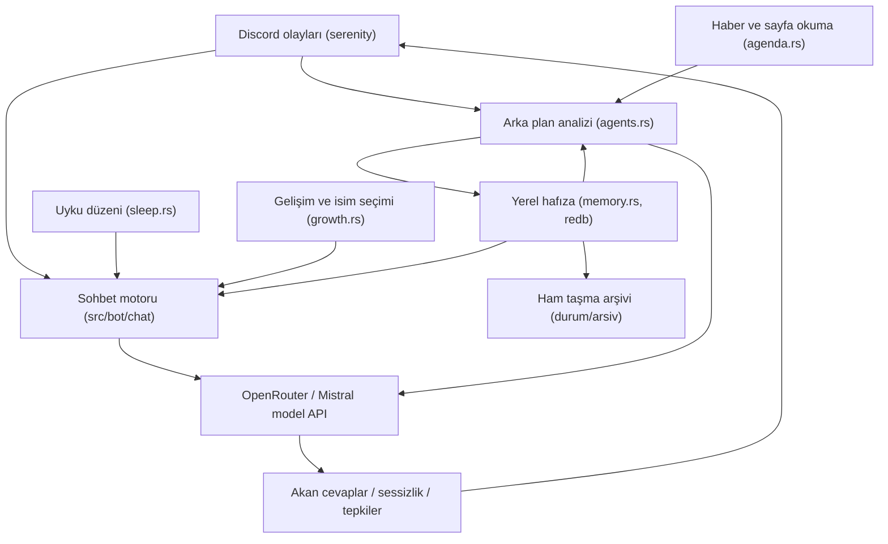

# discord-bot

Kendi kişiliğini geliştiren bir Discord botu.

[](https://github.com/krxi/discord-bot/actions/workflows/rust.yml)
[](https://github.com/krxi/discord-bot/releases)
[](LICENSE)
[](https://github.com/krxi/discord-bot/pkgs/container/discord-bot)

[English](README.md) · [Yeni başlayanlar için kurulum](docs/setup-guide.md) · [Sürümler](https://github.com/krxi/discord-bot/releases)

## Bu ne?

Çoğu Discord botu bir otomat gibidir: bir komuta basarsın, bir cevap alırsın.
Bu bot daha çok bir ev arkadaşı gibidir; sunucuda sizinle takılır. İnsanları ve şakaları
hatırlar, geceleri uyur, söyleyecek bir şeyi olduğunda sohbete katılır.

Grubunuz konuştukça görüşleri oluşur, üslubu değişir. Zamanla kendi adını bile seçer.
Yine de bir insan değil, yazılımdır. Kendi bilgisayarınızda veya sunucunuzda çalıştırırsınız;
cevaplarını bir yapay zekâ hizmeti yazar.

## Nesi farklı?

- **Değişen bir kişilik.** Arka plan ajanları sohbetlerden öğrenir, huyunu günceller,
  kendi hataları hakkında not bırakır. Sürekli bir promptu yeniden yazmanız gerekmez.
- **Yeniden başlatınca kaybolmayan hafıza.** Kişiler, konular ve olaylar yerel bir veritabanında
  saklanır. Eski notlar otomatik silinmek yerine özetlenir ve arşivlenir.
- **Ne zaman konuşacağına karar verir.** Normal sohbete katılabilir, susabilir veya emoji
  tepkisi bırakabilir. Bir uyku düzeni vardır ve haberleri okur.
- **Çalıştırmak ve değiştirmek sizin elinizde.** Rust, tek bir gömülü veritabanı, İngilizce
  veya Türkçe ve kendi OpenRouter ya da Mistral anahtarınız. Docker ve indirilebilir programlar var.

## Ücretli mi? Gizli mi?

Yazılım MIT lisansıyla ücretsizdir. Model sağlayıcınız kullanım ücreti alabilir;
arka plan ajanları da istek gönderir. OpenRouter'da adı `:free` ile biten modeller vardır,
ancak [istek sınırları](https://openrouter.ai/docs/api_reference/limits) uygulanır.
Varsayılan model **ücretsiz bir model değildir**. Sağlayıcı anahtarınıza harcama sınırı koyun;
kiralık sunucunun da ayrı bir ücreti olabilir.

Kaydedilen hafıza sizin makinenizde kalır. Mesajlar, ilgili geçmiş ve hafıza seçtiğiniz model
sağlayıcısına gider; görsel analizi açıksa görseller de gönderilebilir. OpenRouter kullanırken
isteği karşılayan model sağlayıcısı da bu bağlamı alır. Kendi makinenizde çalıştırmanız,
bütün işlemlerin yerel yapıldığı anlamına gelmez. Botu eklemeden önce üyelere bilgi verin.
Sohbet Discord üzerinden taşınır; bot ayrıca haber/sayfa indirir ve ayarlanmışsa Firecrawl kullanır.

[Kurulum rehberinde ücretsiz sınırlar, maliyet, gizlilik ve yedekleme anlatılıyor.](docs/setup-guide.md)

## Çalıştıralım

> **Hiç terminal kullanmadınız mı? [Adım adım rehberi izleyin → docs/setup-guide.md](docs/setup-guide.md).**
> İngilizce rehber, Windows komutları dahil her tıklamayı anlatıyor.

Bir Discord bot token'ı ve model API anahtarı gerekiyor.
[Discord Geliştirici Portalı](https://discord.com/developers/applications)'nda
**Bot → Privileged Gateway Intents** altında **Message Content Intent** ve
**Server Members Intent** seçeneklerini açın. Token ve anahtarları şifre gibi gizli tutun.

### Docker — önerilen yol

Önce [Docker'ı](https://docs.docker.com/get-started/get-docker/) kurup açın.
Bu komutlar macOS/Linux içindir; [PowerShell karşılıkları rehberde](docs/setup-guide.md#5-download-and-start-the-bot).

**1. Botunuz için bir klasör oluşturup içine girin.**

```sh
mkdir mybot && cd mybot
```

**2. Docker'a botu nasıl çalıştıracağını söyleyen dosyayı indirin.**

```sh
curl -O https://raw.githubusercontent.com/krxi/discord-bot/main/docker-compose.yml
```

**3. Ayarlarınızı sorup kaydeden kurulum sihirbazını başlatın.**

```sh
docker run --rm -it --user "$(id -u):$(id -g)" -v "$PWD:/data" ghcr.io/krxi/discord-bot:latest init
```

**4. Botu arka planda çalıştırın.**

```sh
docker compose up -d
```

Sihirbazın verdiği davet bağlantısını açın, sunucunuzu seçin, sonra `@Botunuz merhaba!` yazın.
Docker açık kalsın. Olanları `docker compose logs -f` ile görün;
`docker compose pull && docker compose up -d` ile güncelleyin.

Docker imajı [`ghcr.io/krxi/discord-bot`](https://github.com/krxi/discord-bot/pkgs/container/discord-bot);
amd64 ve arm64 desteklenir. Kök dizindeki `docker-compose.yml`, `bot` servisini çalıştırır,
`.env` dosyasını okur, hafızayı `durum` adlı volume'de (kalıcı depolama alanında) tutar ve
isteğe bağlı görsel şakalar için `./photos` klasörünü salt okunur bağlar.

### Hazır program — Docker veya Rust gerekmez

[GitHub Releases](https://github.com/krxi/discord-bot/releases)'ten bilgisayarınıza uygun
arşivi indirip açın: Linux x86_64/arm64, macOS Apple Silicon veya Windows x86_64.
O klasörde bir terminal açın.

```sh
# macOS / Linux (gerekirse önce: chmod +x discord-bot)
./discord-bot init
./discord-bot
```

```powershell
# Windows PowerShell
.\discord-bot.exe init
.\discord-bot.exe
```

Verilen davet bağlantısını kullanın. Bot çalışırken terminal açık kalsın.

### Kaynak koddan — geliştiriciler için

Git ve kararlı Rust kuruluysa:

```sh
git clone https://github.com/krxi/discord-bot.git
cd discord-bot
cargo run -- init
cargo run --release
```

Sihirbaz sırasıyla **token → sağlayıcı (`openrouter`/`mistral`) → API anahtarı → model →
dil (`en`/`tr`) → sahibin kullanıcı ID'si → UTC farkı** sorar. `.env` yazar (Unix'te `600`
izinleriyle) ve `67226688` izinlerini içeren davet URL'sini verir. Token'dan uygulama ID'sini
çıkaramazsa bir bağlantı şablonu verir. Var olan `.env` korunur; `init --force` üzerine yazar,
bu yüzden dikkatli kullanın.

Discord token'ı yoksa başlangıçta `discord-bot init` çalıştırmanız söylenir. Bot henüz hiçbir
sunucuda değilse başlangıç kaydında davet bağlantısı tekrar görünür. İsteğe bağlı şaka
görsellerini `photos/` içine koyun (png/jpg/gif/webp).

## Nasıl çalışıyor?



Konuşan taraf kişilikli `generate` / `generate_stream` kullanır; arka plan analizi `analyze`
kullanır. Ajanlar yapılandırılmış notlar yazar; bu notlar sonraki cevaplara bağlam olur.
Sabit bir çekirdek kişilik ve gelişen hafıza vardır; model eğitimi yapılmaz.
Bkz. [mimari](docs/architecture.md) ve [tasarım kararları](docs/decisions.md).

### Arka plan ajanları

| Ajan | Ne zaman | Ne üretir |
|---|---|---|
| **profiler** | ilk katılım taraması ve uyanıkken 6 saatlik döngü | grup profili, iç şakalar, konular (`profil.md`) |
| **diarist** | biten sohbetler ve kuyruktaki gözlemler | kişi puanları/notları, konu notları, olaylar, güncel öz durum |
| **coach** | başlangıçta huy yoksa, uyanıkken 6 saatlik döngü | huy ve ilgi alanları (`huy.md`) |
| **critic** | biten sohbetler | kendi mesajlarına düzeltme notları (`duzeltmeler.md`) |
| **summarizer** | hafıza kaydı sınırını aşınca | kısa kayıt; ham taşma arşive gider |
| **news_agent** | 6 saatlik döngü; uykuda haber saklama dahil | Hacker News ve seçilen RSS'ten gruba uygun haber |
| **wanderer** | uyanıkken 4 saatlik döngü | haberlerden oluşan görüşler (`gundem.md`) |
| **image_commenter** | görsel şaka anında | kısa, kişilikli görsel yorumu |
| **mood** | sohbet açılınca, sonra her 4 turda | o sohbetin anlık ruh hali (kalıcı değil) |

Görsel yorumu bir konuşma yoludur, kişiliksiz analiz değildir. Diğer ajanlar sohbet kişiliğini
kullanmadan analiz yapar. Planlı işler uykuda veya seyahatte atlanabilir.

### Hafıza modeli

Her cevaba küçük bir dizin eşlik eder; ilgili detaylar **6.000 karakterlik bütçe** içinde
getirilir. Sınırını aşan kayıtlar özetlenir; ham malzeme otomatik silinmez, arşivlenir.
Arşiv insanların incelemesi içindir, bot buradan bilgi getirmez. Bu, saklanan malzemeyi
korur; her mesajın kusursuz hatırlanacağı anlamına gelmez.

Gömülü ve işlemsel [redb](https://github.com/cberner/redb) veritabanı, metin-yol anahtarları kullanır:

```text
durum/
  hafiza.redb           şu anahtarları içeren veritabanı:
    INDEX.md             kişiler, puanlar, etiketler, konular, olay sayısı
    huy.md               huy
    profil.md            grup profili
    duzeltmeler.md        düzeltmeler
    kendim.md             güncel öz durum
    gundem.md             haber günlüğü
    kisiler/<id>.md       Discord ID'sine bağlı kişi kayıtları
    konular/<name>.md     tarihli konu notları
    olaylar/YYYY-MM.md    biten sohbet olayları
  arsiv/               okunabilir dosyalarda ham taşma
```

Cevap bağlamı; çekirdek kişilik, gelişim evresi, huy, grup profili, dizin, gündem, öz durum,
düzeltmeler, getirilen kişi/konu/olaylar, sohbetin ruh hali ve görevden oluşur.
Detaylar: [durum dosyaları](docs/state-files.md) ve [mimari](docs/architecture.md).

## Teknoloji yığını

| Bileşen | Seçim |
|---|---|
| Dil | Rust, edition 2021 |
| Discord / çalışma zamanı | serenity 0.12 / tokio |
| HTTP | rustls kullanan reqwest |
| Modeller | OpenRouter veya Mistral; `API_URL` ile OpenAI uyumlu uç nokta değiştirilebilir |
| Hafıza | redb, gömülü işlemsel veritabanı |
| Ayarlar | dotenvy ile `.env` |
| CI / sürümler | fmt, clippy, testler, Docker derlemesi; `v*` etiketleri program ve imaj yayımını başlatır |

## Ayarlar

Bkz. [`.env.example`](.env.example). Ortam ayarlarını değiştirdikten sonra yeniden başlatın.

| Değişken | Zorunlu | Amaç |
|---|---|---|
| `DISCORD_TOKEN` | evet, CLI sohbeti hariç | Discord botunun şifresi |
| `OPENROUTER_KEY` / `MISTRAL_KEY` | biri | model API anahtarı; ikisi de varsa OpenRouter seçilir |
| `PROVIDER` | hayır | `mistral`, Mistral'i zorunlu seçer |
| `MODEL` | hayır | varsayılanlar: `openai/gpt-4o-mini` / `mistral-medium-latest`; kaydedilmiş `/model` seçimi önceliklidir |
| `API_URL` | hayır | özel OpenAI uyumlu chat/completions uç noktası |
| `OWNER_ID` | hayır | Discord kullanıcı ID'niz: hep sevilir, `/model` değiştirebilen tek kullanıcıdır; boşsa sahip yoktur |
| `TZ_OFFSET` | hayır | uyku düzeni için UTC'den saat farkı, varsayılan `0`; `5.5` gibi kesirler çalışır |
| `BOT_LANG` | hayır | `en` (varsayılan) veya `tr` |
| `NEWS_RSS` | hayır | RSS kaynağı; `en` için BBC World, `tr` için Sözcü varsayılır |
| `FIRECRAWL_KEY` | hayır | sayfa çıkarımı ve web araması; yoksa sayfalar düz indirilir |
| `NEWS_CHANNEL` | hayır | haber kanalı ID'si; yoksa sunucunun sistem kanalı |
| `GUILD_ID` / `CHANNELS` | hayır | izinli sunucu / virgülle ayrılmış kanal ID'leri; boşsa erişilen her yer |
| `DEBUG_CHANNEL` | hayır | açılan karar izlerinin gideceği kanal |
| `IMAGE_ANALYSIS` | hayır | görsel okuma varsayılan açık; `off` kapatır |
| `STEALTH` | hayır | varsayılan kapalı; `on`, slash kaydını/etkileşimlerini ve arayüz kartlarını atlar, düşünmeyi gizler, canlı düzenleme yerine biten cevabı yollar |
| `LOG_LEVEL` / `LOG_COLOR` | hayır | `error/warn/info/debug/trace` (varsayılan `info`); terminalde renk varsayılan açık |

Kod içi sabitler: [docs/constants.md](docs/constants.md).

## Discord olmadan konuşmak

```sh
cargo run -- chat
```

Terminalde sohbet denemesi; yalnız model anahtarı gerekir. `isim: metin` yazın (isim yoksa
`misafir`), çıkmak için `!quit` veya Ctrl-D. Var olan hafızayı okur ama sohbet değişikliklerini
kaydetmez. İlk kurulumda hafıza veritabanı oluşabilir. Promptları denemek için kullanışlıdır.

```sh
cargo run -- migrate-durum [--from <dir>] [--to <redb-path>] [--dry-run] [--force]
```

Eski düz-markdown hafıza ağacını kaynakları taşımadan veya silmeden redb'ye aktarır.
Bkz. [durum dosyaları](docs/state-files.md).

## Slash komutları

`BOT_LANG=en` ile İngilizce, `BOT_LANG=tr` ile Türkçe adlar kullanılır.
Yönetim `!` komutlarıyla değil slash komutlarıyla yapılır. Sonuçlar yalnız çağırana görünen
kartlardır; haber paylaşma gibi eylemler kanala da mesaj gönderebilir. Stealth kipinde
etkileşimler yok sayılır.

| İngilizce / Türkçe | İşlev |
|---|---|
| `/status` / `/durum` | gelişim, sayaçlar, model, uyku, düşünme, seyahat, token metrikleri, sürüm |
| `/help` / `/yardim` | komut listesi |
| `/mind [test]` / `/zihin [test]` | Kişiler/Konular/Olaylar kartı, kişi seçici ve detay pencereleri; `test` son 30 satırı tanılar |
| `/settings` / `/ayarlar` | düşünme, debug, uyku paneli |
| `/reset [all]` / `/sifirla [hepsi]` | kanal durumunu ve açık sohbeti sıfırla; istenirse tüm kanallar |
| `/news` / `/haber` | şimdi haber paylaş |
| `/problem` / `/sorun` | yazılım şikâyeti paylaş |
| `/wander` / `/gez` | gündem gezinmesini çalıştır |
| `/prank` / `/saka`, `/hack` | görsel şakası / hacklendi numarası |
| `/agents` / `/ajanlar` | profiler ve coach'u çalıştır |
| `/wake` / `/uyan`, `/sleep [hours]` / `/uyu [saat]` | erken uyandır / test uykusu (varsayılan 8 saat) |
| `/thinking [mode]` / `/dusunme [kip]` | göster, gizle, sessiz veya kapalı |
| `/model [id]` | modeli göster; yalnız `OWNER_ID` değiştirebilir, yeniden başlatınca korunur |
| `/debug [state]` / `/debug [durum]` | isteklilik, hedef, ruh hali, susma/tepki karar izleri |

Ağ/model kullanan komutlar, Discord'un yanıt süresini aşmamak için önce cevabı erteler.

## Çok dilli destek

`BOT_LANG` varsayılan olarak **İngilizce**dir ve süreç boyunca sabittir.
`prompts/<lang>/` içindeki promptlar ve `langs/<lang>.json` içindeki arayüz metinleri birlikte
değişir. Yeni dil için çeviri dosyaları ve Rust dil/dağıtım girdileri gerekir;
bkz. [promptlar](docs/prompts.md). Bazı iç durum alanları ile uyku günü/ruh hali anahtar
kelimeleri hâlâ Türkçedir.

Seyahat kipi Türk tatil takvimini kullanır ve **yalnız `BOT_LANG=tr` ile** çalışır.
İngilizce takvim [yol haritasında](docs/roadmap.md).

## Güvenlik

- Botlara, webhook'lara ve özel mesajlara cevap verilmez. `GUILD_ID`/`CHANNELS` erişimi daraltır.
- Giden etiketlemeler sınırlıdır; sıradan üretilmiş etiketler herkese bildirim gönderemez.
- Kanal başına bir cevap işlemi vardır; RAII koruması çıkışta veya panikte kilidi kaldırır.
  Bu bir harcama garantisi değildir: sağlayıcınızın harcama kontrollerini kullanın.
- Model çağrıları token bütçelidir. Bağlantıda 15 saniye, okumada 120 saniyelik boşluk zaman
  aşımı vardır; geçici ağ/429/5xx hataları iki kez yeniden denenebilir.
- Kişilik promptu, kuralları değiştirme girişimlerini sohbet olarak ele almasını söyler;
  hacklendi şakasında bilgi veya bağlantı istemesini yasaklar. Promptlar güvenlik sınırı değildir.
- `.env`, `durum/`, `photos/` içeriği ve `bot.log` git dışında tutulur. Ekran görüntüsü,
  kayıt veya destek talebinde yanlışlıkla paylaşmayın. `init`, Unix'te `.env` izinlerini `600` yapar.

## Dokümantasyon haritası

Aşağıdaki belgeler İngilizcedir.

| İhtiyaç | Nerede |
|---|---|
| Yeni başlayanlar için kurulum, maliyet, gizlilik, yedekleme | [docs/setup-guide.md](docs/setup-guide.md) |
| Katkı kuralları / geliştirme tarifleri | [AGENTS.md](AGENTS.md), [CONTRIBUTING.md](CONTRIBUTING.md), [docs/development.md](docs/development.md) |
| Yapılanlar / bekleyen işler | [docs/progress.md](docs/progress.md), [docs/roadmap.md](docs/roadmap.md) |
| Mimari / veri akışı | [docs/architecture.md](docs/architecture.md) |
| Modüller / çağıranlar | [docs/modules.md](docs/modules.md) |
| Olay bazında davranış | [docs/flows.md](docs/flows.md) |
| Hafıza biçimleri / sınırlar | [docs/state-files.md](docs/state-files.md) |
| Promptlar / yer tutucular | [docs/prompts.md](docs/prompts.md) |
| Sabitler | [docs/constants.md](docs/constants.md) |
| Tasarım kararları | [docs/decisions.md](docs/decisions.md) |
| Türkçe çalışma zamanı sözlüğü | [docs/glossary.md](docs/glossary.md) |
| Tanıtım taslakları / elle yapılacaklar | [docs/launch.md](docs/launch.md) |

## Sık sorulanlar

<details>
<summary>Ortalığı mesaja boğar mı?</summary>

Her normal mesaja cevap vermez. Sohbete girip girmeyeceğini isteklilik puanı belirler;
bu değerlendirme **kanal başına en fazla iki dakikada bir** yapılır. Temel eşik **6/10**'dur;
gelişim ve seyahat bunu değiştirir. Uyanıkken etiketlemeler ve aynı kişiyle süren konuşma bu
beklemeyi atlar — bütün mesajlara uygulanan bir bekleme değildir. Puanlama başarısız olursa
rastgele seçimle yine katılabilir. Ayrıca saatte bir kendiliğinden konuşma denemesi (gelişime
göre değişen %30 temel ihtimal), haberler ve isteğe bağlı şakalar vardır. Cevapta modelin
yazdığı en fazla dört satır kullanılır; uzun satırlar ve gösterilen düşünceler ek mesaj
oluşturabilir. Küçük, ayrılmış bir kanalla başlayın; `CHANNELS` ile erişimi sınırlayın.

</details>

<details>
<summary>Ekran kartı gerekiyor mu?</summary>

Hayır. Normal kurulum internet üzerinden OpenRouter veya Mistral'e bağlanır; model sizin
bilgisayarınızda çalışmaz. Bilgisayarınızın veya sunucunuzun açık kalması gerekir.

</details>

<details>
<summary>Modeli değiştirebilir miyim?</summary>

Evet. `.env` içinde `MODEL` ayarlayın veya `OWNER_ID` ile belirlenen hesaptan `/model <id>`
kullanın. Slash komutuyla yapılan seçim kaydedilir ve yeniden başlatırken `.env`'den önce gelir.
ID vermeden `/model`, mevcut modeli gösterir. Sağlayıcının model listesini ve fiyatlarını kontrol edin.

</details>

<details>
<summary>Gece ne oluyor?</summary>

Normalde **01.00–09.00 civarında** uyur; iki uçta da 45 dakikaya kadar oynama vardır.
Saat, `TZ_OFFSET` ile belirlenir (varsayılan UTC). Ara sıra uykusuz bir gece düzeni kaydırır.
Çevrimiçi kalıp gelen mesajları arka plan hafıza işi için kaydeder ama uykuda sohbet etmez;
uyanınca gece mesajlarını ve bekleyen etiketlemeleri değerlendirir. Erken uyandırmak için
`/uyan` (İngilizcede `/wake`) kullanın.

</details>

<details>
<summary>Hafızayı nasıl yedeklerim?</summary>

Kopyalamadan önce botu durdurun. Hazır program/kaynak kurulumunda `hafiza.redb` ve `arsiv/`
dahil bütün `durum/` klasörünü yedekleyin. Docker'da Compose'un `durum` volume'ünü yedekleyin;
[rehberde kopyalanabilir komutlar var](docs/setup-guide.md#back-up-the-memory).
`.env` dosyasını ayrıca güvenli biçimde saklayın. `docker compose down` hafızayı korur;
**`docker compose down -v` volume'ü siler.**

</details>

## Katkıda bulunmak

[CONTRIBUTING.md](CONTRIBUTING.md) ve
[good first issue listesine](https://github.com/krxi/discord-bot/issues?q=is%3Aissue%20is%3Aopen%20label%3A%22good%20first%20issue%22)
bakın. Başlangıç önerileri: özel emoji tepkileri, İngilizce seyahat takvimi, İngilizce uyku
günü/ruh hali anahtar kelimeleri ve takıntı konusu anahtar kelime kancası. Bunlar bekliyor,
henüz sunulan özellikler değil.

```sh
cargo build
cargo test                        # v1.1.0 yerel kontrolünde 93 test geçti
cargo clippy --all-targets -- -D warnings
cargo fmt
```

CI, `main`'e push/PR geldiğinde biçim, clippy, test ve Docker derlemesini kontrol eder.
Değişmez kurallar ve canlı doğrulama eksikleri için [AGENTS.md](AGENTS.md)'ye bakın.

## Yıldız geçmişi

[](https://star-history.com/#krxi/discord-bot&Date)

## Lisans

[MIT](LICENSE). Lisans koşullarıyla kullanabilir, değiştirebilir ve paylaşabilirsiniz.

## 1.0'dan yükseltmek

Önce hafızayı yedekleyin. Önceki Türkçe dili, UTC+3 düzenini ve sahip davranışını korumak için
mevcut `.env` dosyanıza şunları ekleyip yeniden başlatın:

```dotenv
BOT_LANG=tr
TZ_OFFSET=3
OWNER_ID=<your id>
```

`<your id>` yerine Discord kullanıcı ID'nizi yazın ([nasıl bulunur](docs/setup-guide.md#3-find-your-discord-user-id)).
Sahip artık koda gömülü değil. Bu ayarlar olmadan dil İngilizce, uyku saati UTC olur ve sahip
belirlenmez. `NEWS_RSS`, İngilizcede BBC World, Türkçede Sözcü olur; seyahat yalnız Türkçede
çalışır. Çalıştırma yolunu değiştirirken mevcut `durum/` verinizi koruyun — Docker volume
kullanır, makinenizdeki klasörü kendiliğinden devralmaz.
