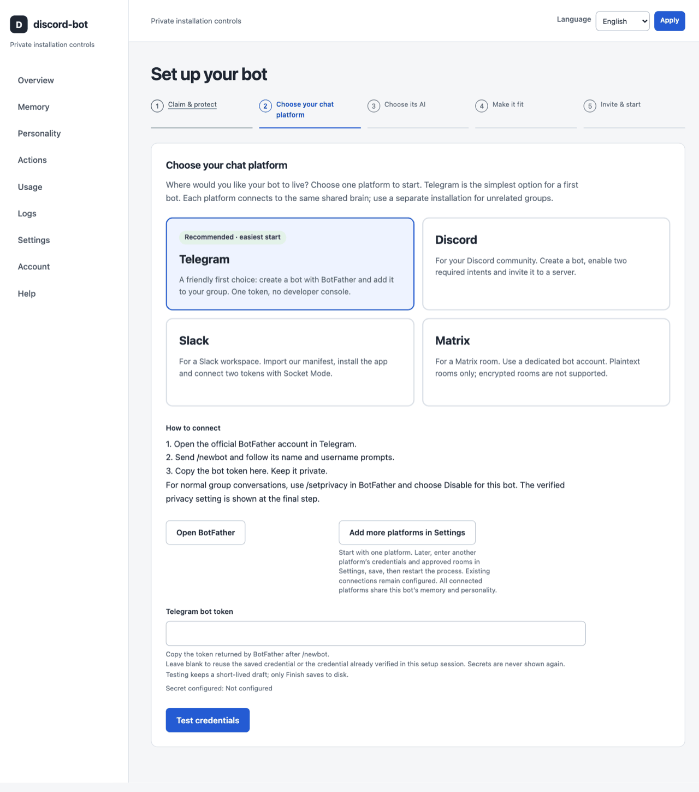
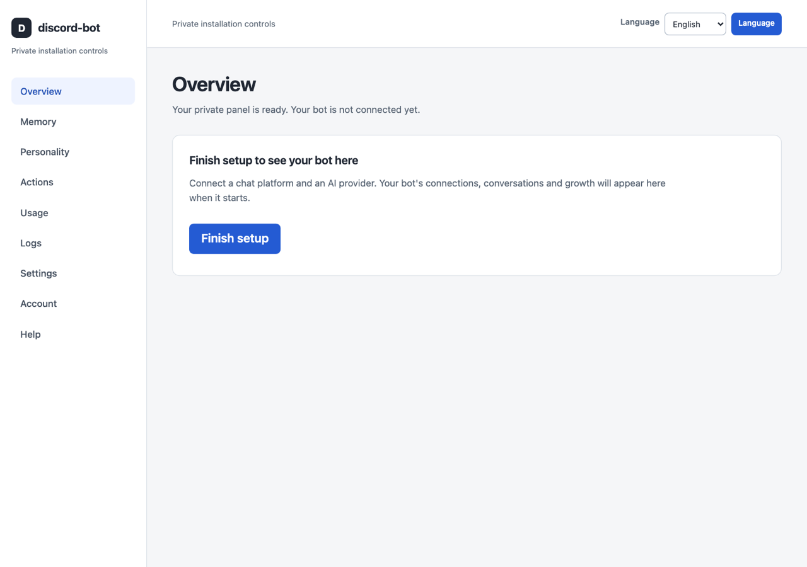
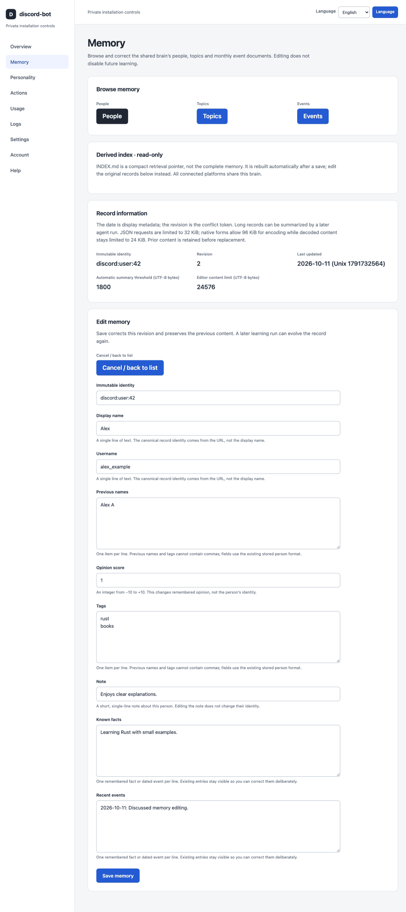
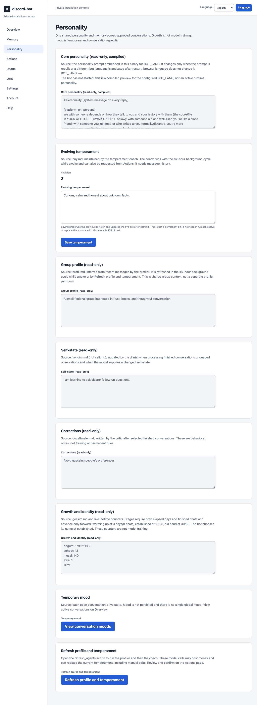

# discord-bot

Discord, Telegram, Slack veya Matrix grup sohbetinize eklediğiniz; insanları hatırlayan, ruh halleri ve uyku düzeni olan, kendiliğinden sohbete katılan ve sizin bilgisayarınızda çalışan bir yapay zeka karakteri.

- Tarayıcınızdan kurun ve yönetin.
- İnsanlar hakkında hatırladıklarını görün ve düzeltin.
- Birkaç sohbet uygulamasını aynı hafıza ve kişiliğe bağlayın.

[English](README.md) · [Adım adım kurulum](docs/setup-guide.md) · [Değişiklikler](CHANGELOG.md)

## Yönetim ekranları nasıl görünüyor?



*Gerçek yerel yönetim paneli: kurulum sırasında sohbet uygulaması seçimi. Canlı sohbet veya gizli anahtar gösterilmiyor.*

<details>
<summary>Genel bakış, hafıza düzenleyicisi ve kişilik sayfasını görün</summary>



*Gerçek yönetim paneli: sohbet bağlantısı kurulmadan önce Genel Bakış. Bu, çalışan bir sohbetin demosu değil.*



*Gerçek yönetim paneli: bir kişi kaydını düzenleme. “Alex” ve kayıtlı notlar kurgusal demo verileridir; bir üyenin sohbeti değildir.*



*Gerçek yönetim paneli: huy düzenleme ve salt okunur kişilik bağlamı; notlar kurgusal demo verileridir. Bu görüntüler arayüzü gösterir, ölçülmüş kişilik gelişimini değil.*

</details>

## 3 adımda başlayın

Önce [Docker](https://docs.docker.com/get-started/get-docker/) kurup açın. Grubunuza bot ekleme izni ve bir yapay zeka hizmeti hesabı/anahtarı gerekir. Mac/Linux'ta Terminal'e üç komut kopyalayacaksınız; [Windows PowerShell komutları ve uygulama ayarları](docs/setup-guide.md#start-with-docker) rehberde bulunur.

**1. Bir klasör oluşturun ve başlatma dosyasını indirin.**

```sh
mkdir mybot && cd mybot && curl -O https://raw.githubusercontent.com/krxi/discord-bot/main/docker-compose.yml
```

**2. Başlatın.**

```sh
docker compose up -d
```

**3. Kurulum bağlantısını açın.**

```sh
docker compose logs bot
```

`http://localhost:8787/setup#token=...` bağlantısını bulun ve aynı bilgisayardaki tarayıcınızda açın. Bu bağlantı gizlidir, tek kullanımlıktır ve 15 dakika sonra geçersiz olur. Tarayıcı sihirbazı yönetici parolası belirlemenizi, sohbet uygulaması seçmenizi, bot bilgilerini ve yapay zeka anahtarını girmenizi, okuyabileceği odaları seçmenizi ve botu başlatmanızı ister. Uygulama hesaplarının kendi kurulum adımları da gerekir; sihirbaz bunları açıklar. [Bağlantı süresi dolduysa veya uzak sunucu kullanıyorsanız](docs/setup-guide.md#browser-setup).

Kurulumdan sonra **http://localhost:8787** adresinde bağlantıları görebilir, hafıza/huy notlarını düzenleyebilir, işlemleri çalıştırabilir, kullanım/kayıtları inceleyebilir ve ayarları değiştirebilirsiniz. Panel varsayılan olarak yalnız bu bilgisayardan erişilir; 8787 portunu internete açmayın. Bilgisayarınız ve Docker açık kalsın. Normal cevaplara güvenmeden önce [sohbet bağlantısını doğrulayın](docs/setup-guide.md#verify-the-connection).

Docker ayarları ve hafızayı kalıcı birimlerde tutar; bilgisayarınızda `.env` hazırlamanız gerekmez. [Gizli yedekler ve dosyayı elle düzenleme seçeneği](docs/setup-guide.md#where-your-memories-live) rehberde açıklanır.

Terminal alternatifi: `discord-bot init` ile [komut satırından kurulum](docs/setup-guide.md#headless-cli-setup) hâlâ kullanılabilir.

Docker olmadan: [hazır binary](docs/setup-guide.md#download-a-release) indirin, terminalden başlatın ve kurulum bağlantısını açın; Rust gerekmez.

**v1 veya eski bir Compose dosyası zaten çalışıyor mu?** Önce [yükseltme adımlarını okuyun](docs/setup-guide.md#existing-compose-installations). Hafıza yedek alınarak otomatik taşınır; Docker artık ayarları bilgisayarınızdaki `.env` dosyasında değil, özel `discord-bot-config` biriminde tutar. [Her iki birimi yedekleyin](docs/setup-guide.md#back-up-the-memory).

## Sohbet uygulamanızı seçin

Dördü de aynı yapay zekayı ve hafızayı kullanır. Uygulamaların izin verdiği özellikler farklıdır:

| Uygulama | Çalışan özellikler | Eklemeden önce bilin |
|---|---|---|
| **Discord** | Sohbet, yanıtlar, tepkiler, görseller, slash komutları ve özel kontrol kartları; ilk taramada erişilebilir geçmişin 14 güne kadarı. | **Message Content Intent** ve **Server Members Intent** açın; Presence Intent açmayın. Başlamadan kanalları kısıtlayın; boş Discord filtreleri tüm erişilebilir kanallar demektir. |
| **Telegram** | Grup sohbeti, yanıtlar/forum konuları, izinli emoji tepkileri, görseller ve özel sahip kontrolleri. | Normal mesajları okuyabilmesi için BotFather **gizlilik modunu** kapatıp botu yeniden ekleyin veya grup yöneticisi yapın. Odaları açıkça onaylayın. Eski grup geçmişini getiremez. |
| **Slack** | Kanal/konu sohbeti, tepkiler, görsel/dosyalar, sınırlı geçmiş ve özel sahip kontrolleri. | **Socket Mode**, bir uygulama tokenı ve bir bot tokenı kullanır. Onaylı kanallara davet edin. Slack slash komutları yoktur; sahip olarak `!status` veya `@bot status` kullanın. |
| **Matrix** | Onaylı şifresiz odalarda sohbet, yanıtlar, tepkiler, görseller, sınırlı geçmiş ve sahip kontrolleri. | **Yalnız düz metin:** şifreli odalar ve ekler desteklenmez. Yanıtlar desteklenir, Matrix konu başlıkları desteklenmez. Sahip belirleyip odaları onaylayın; Discord tarzı düğme/menüler yoktur. |

İzinler bu özellikleri sınırlayabilir. Anahtar testinin başarılı olması, botun bir odada okuyup cevap verebildiğini kanıtlamaz. Bkz. [uygulama kurulumu](docs/setup-guide.md) ve [özellik ayrıntıları](docs/architecture.md#platform-boundary).

## “Hatırlamak” ne demek?

Sohbetlerden sonra arka plandaki yapay zeka çağrıları insanlar, konular ve botun cevapları hakkında notlar yazar. Sonraki cevaplar seçilmiş notları sabit bir karakter promptuyla birlikte kullanır. **Memory** sayfasında notları inceleyip düzeltebilir, **Personality** sayfasında huyunu düzenleyebilirsiniz; sonraki arka plan işleri bu düzenlemeleri yeniden değiştirebilir.

Değişen şey bağlamdır, model ağırlıkları değil. Hatırlama sınırlıdır, ruh halleri konuşma bazındadır ve sıradan mesajlara cevap, tepki veya sessizlik gelebilir. Karakter bir yapay zeka botudur; içtenlikle sorulan kimlik sorularına dürüstçe cevap verir. [Nasıl çalışır?](docs/architecture.md)

## Maliyet

Henüz ölçülmüş bir çalıştırma maliyeti yayımlamadık. Cevaplar ve arka plan analizi model anahtarınızı kullanır. Sağlayıcı harcama limitiyle başlayın ve kullanım panelini kontrol edin.

Varsayılan modeller **ücretlidir**. Ücretsiz seçeneklerin erişilebilirliği ve limitleri değişebilir; arka plan çağrıları da bu limitleri tüketir. Panel gözlemlenen kullanımı gösterir, eksiksiz fatura veya harcama limiti değildir. [Model seçimi](docs/setup-guide.md#model-keys-and-cost).

## Gizlilik ve veri akışı

Botu eklemeden **önce** üyelere neleri okuyabileceğini söyleyin. Yalnız güvenilen odaları seçin: **bağlı tüm uygulamalar tek hafızayı paylaşır**, dolayısıyla bir odada öğrenilen şey başka bir cevabı etkileyebilir. Birbirinden bağımsız gruplar için ayrı kurulumlar kullanın.

| Nerede? | Oraya giden veri |
|---|---|
| Bilgisayarınız | Kayıtlı notlar, özetler, yakın oda geçmişi, saklanan düzenleme geçmişi ve arşivler; ayrıca oluşturduğunuz yedekler. |
| Model hizmetiniz | Cevap/analiz için seçilmiş mesajlar ve kayıtlı notlar. Görsel analizi varsayılan olarak açık olduğundan görseller de gönderilebilir; gerekirse Ayarlar'dan kapatın. OpenRouter isteği karşılayan model sağlayıcısına da gönderir. |
| Firecrawl, açıksa | Web okuma/arama için sayfa adresleri ve arama sorguları. |

Bot uyurken de onaylı mesajları gözlemler. **Üye bazında seçici silme desteklenmez**; sohbeti sıfırlamak kişi kayıtlarını, önceki sürümleri, arşivleri veya yedekleri silmez. Kendiniz çalıştırmanız, yapay zeka işlemesinin yerel olduğu anlamına gelmez. [Toplama, saklama ve silme ayrıntıları](docs/setup-guide.md#privacy).

## Katkı ve lisans

Dokümanlar, çeviriler ve tekrarlanabilir hata raporlarıyla katkı verebilirsiniz; Rust bilmeniz gerekmez. Kod değişiklikleri için fork alın, dal oluşturun ve pull request açın. [Katkı rehberi](CONTRIBUTING.md) · [Teknik dokümanlar](docs/README.md).

MIT — bkz. [LICENSE](LICENSE).
