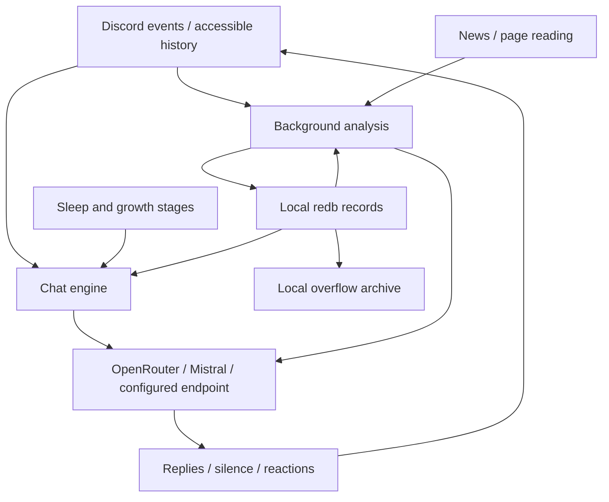

# Architecture

Discord events enter the chat engine. Replies combine the core persona, evolving notes, retrieved memory, and the current task. Finished chats are queued for background memory analysis. This changes reply context, not model weights; there is no fixed 12-message conversation limit.

## Data boundaries

Selected messages, saved notes, and optionally images leave the host for model processing. A first scan reads up to 14 days of accessible text history, subject to configured scope and permissions. Observation continues while asleep. Firecrawl receives URLs/search queries when configured. [Privacy and retention](setup-guide.md#privacy) are deployment concerns, not properties supplied by redb.

## Source layout

| Entry point | Responsibility |
|---|---|
| `src/main.rs`, `src/bot/setup.rs` | process/configuration and startup |
| `src/bot/types/` | shared state and limits |
| `src/bot/handler/` | Discord events, scope filters, willingness decisions |
| `src/bot/chat/` | conversation turns and research |
| `src/bot/provider/` | requests, personality/analysis split, streaming and send paths |
| `src/bot/text/` | pure reply parsing and text helpers |
| `src/bot/cycle/` | background loops, memory queues and actions |
| `src/command.rs`, `src/command/`, `src/modal.rs` | slash registration, handlers and UI cards |
| `src/agents.rs`, `src/agenda.rs` | analysis and web/news work |
| `src/memory.rs`, `src/migrate.rs` | redb records, retrieval, summarization/archive support and legacy import |
| `src/growth.rs`, `src/sleep.rs`, `src/travel.rs` | growth stages, clock/sleep, Turkish calendar |
| `src/prompts.rs`, `src/strings.rs`, `src/lang.rs` | language dispatch; `BOT_LANG` defaults to `en`, fixed for the process |
| `src/chat_cli.rs`, `src/init.rs` | terminal bench and configuration wizard |

The grouped bot files compile through `include!` in the root module, and command files similarly share their parent scope. This preserves access to private items and macros without duplicating imports. The tradeoff is that a file boundary is not a Rust module boundary; find the aggregator before changing visibility or moving definitions. Detailed navigation: [modules](modules.md).

## State and concurrency

Serenity is vendored under `vendor/serenity` for planned in-tree changes; the Cargo registry patch keeps builds using that tree.

`Bot` owns a `Mutex<State>` and an HTTP client. State includes open chats, channel histories, memory context, sleep plans, queued observations and runtime flags. Take a short lock to snapshot inputs, drop it before network/model awaits, and take another short lock to apply results. **No state/cache lock crosses `.await`.** A per-channel RAII busy guard clears reply ownership on normal exit or unwinding.

Conversation uses `generate` / `generate_stream`, with the persona and evolving context. Background extraction/evaluation uses `analyze`, without the conversational persona. Image commentary is intentionally a talking path.

## Context and storage

A reply combines the fixed language-specific persona, growth stage, temperament, group profile, memory index, bounded retrieved person/topic/event records, agenda, current self-state, clock/travel context, corrections, mood, and task. Retrieval has a 6,000-character budget; the index and fixed profile context are additional. Model output is parsed as a bounded line protocol: text, silence, or Unicode reaction. [Protocol details](flows.md#output-protocol-every-reply-with-personality-goes-through-this).

`durum/hafiza.redb` stores markdown under path-like keys; schema v2 person/room
records use source-qualified domain identities, and topics retain slug keys.
Overflow archives in `durum/arsiv/` are real files for human inspection, not bot
retrieval. New canonical archive names are escaped; historical filenames and
contents are unchanged. See [state files](state-files.md).

## Background work

| Agent | When | Produces |
|---|---|---|
| profiler | first-join scan and awake 6h cycle | group profile (`profil.md`) |
| diarist | finished chats and queued observations | person/topic/event notes and self-state |
| coach | startup when temperament is missing, awake 6h cycle | temperament/interests (`huy.md`) |
| critic | finished chats | correction notes (`duzeltmeler.md`) |
| summarizer | record exceeds its limit | shorter record, raw overflow archive |
| news_agent | 6h cycle, with sleep-time stash | group-relevant news from Hacker News/configured RSS |
| wanderer | 4h cycle while awake | news opinions (`gundem.md`) |
| image_commenter | image-prank time | personality-aware image comment |
| mood | chat opens, then every 4 turns | transient chat mood |

Schedules can skip work while asleep/traveling. Growth thresholds are defined in `src/growth.rs`, not learned; name selection is gradual and depends on the established stage. Travel runs only for Turkish. All reply and analysis calls count toward provider usage.

## Platform boundary

`platform::types` owns opaque, case-sensitive, shared `Arc<str>` identities:
`UserKey`, `SpaceKey`, `RoomKey`, `MessageKey`, `ThreadKey`, and `EventKey`.
Durable identity contains the platform and native scope, never credentials or a
display name. `ConnectionId` identifies a configured session independently.
Typed constructors reversibly escape UTF-8 components, and parsers reject unsafe
or noncanonical representations. Slack timestamps stay text, Telegram room IDs
can remain negative, and the CLI bench uses `terminal:room:local:bench`.

`platform::discord::events` converts SDK/cache data into normalized users, rooms,
safe text, structured mentions/replies, attachments and enriched reactions before
personality decisions. Shared ingress types are `IncomingMessage`, `ReactionEvent`,
`ChatEvent`, and `EventEnvelope`; account identity is connection-local.
`ConversationKey` includes optional topic/thread scope for adapter routing.
Explicit native conversions remain inside Discord transport/UI boundaries.
Memory has completed its canonical schema-v2 cutover. Discord is the only enabled
runtime transport; the interface does not advertise unimplemented networks.

Capabilities describe usable room permissions: ordinary-message visibility,
history/decryption, replies/threads, sending/reactions/edits/deletes/typing,
nickname scope, private results, rich UI, output count units/limits, edit cadence
and upload constraints. Unknown rooms use unavailable capabilities, not assumed
success. Discord retains a 1900-Unicode-scalar output budget.

Offline characterization tests preserve input exclusions, first MIME image/off
selection, safe content, welcome and reply-user mentions, custom emoji labels,
thought/stealth rendering, slash registration and private UI builder semantics.
They are not live Discord network probes. Persisted settings-button `kapali`
remains distinct from slash option `kapat`; existing Discord quirks are retained.

### Fallible memory API

Administrative callers use `memory::read_result(rel: &str)
-> Result<Option<String>, BotError>` and
`memory::write_result(rel: &str, content: &str) -> Result<(), BotError>`.
Missing records return `Ok(None)`; database errors are never presented as empty
memory. Construct identity record keys with `platform::keys::person_record`
or `room_record`, and parse them through the matching canonical parsers.
`memory::init_result(path: &Path) -> Result<(), BotError>` obtains exclusive
ownership and completes the versioned identity migration before state loading.

The migration preserves body bytes and modification times, creates a consistent
v1 snapshot and manifest before cutover, rejects conflicting destinations, and
advances the schema with all identity moves in one write transaction. Unknown
legacy keys and malformed scan entries remain retained/unresolved. Completed
version checks are idempotent. Derived `INDEX.md` is regenerated after success.
Rollback is offline restoration with the old binary, not a reverse runtime alias.

### Outgoing transport and rendering

`platform::Platform` is `Send + Sync` and exposes account/connection metadata,
room-sensitive capabilities and synchronous renderer hooks plus native
return-position `impl Future + Send` operations: `send`, `edit`, `delete`,
`react`, `typing`, `set_nickname`, `fetch_history`, `list_rooms`, and
`resolve_media`. `Adapter` match-delegates to concrete implementations, producing
statically generated futures rather than boxed hot-path trait objects.

`OutgoingMessage<'a>` borrows text through `Cow`, carries structured default-deny
mention/reply policies, attachment sources and optional card/thought presentation.
SDK objects, native markup and interaction tokens remain adapter-private.
`MessageReceipt` contains connection/message/room identities, accepted text and
version; reconciliation skips identical edits and updates accepted state only on
success. Provisional cleanup, line ordering, failed-send bookkeeping, welcome
prefixes, reply-user pings and Discord thought formatting remain characterized.
Missing edit/delete capability buffers final output, missing typing omits only
the network indicator, and an unsupported targeted reaction becomes one plain
emoji; an opening-path reaction without a target is still dropped.

`parse_reply(text, OutputLimits)` caps four logical lines before physical
transport splitting. Discord retains its exact 1900-character split boundaries,
1200 ms edit cadence and non-streaming pacing. Other count units support UTF-16
and encoded bytes without breaking Unicode scalars. Actual adapters must provide
usable budgets (positive scalar limit, at least two UTF-16 units or four UTF-8
bytes); indivisible scalars are never discarded for impossible test budgets.

`ConnectionRegistry` registers concrete adapters, binds `RoomRef` routes and
returns shared handles before awaits. `snapshot() -> Vec<ConnectionSnapshot>`
provides connection status, account identity and room capabilities for local
administration. No SDK client is exposed in the snapshot. Credentials are not
durable identities, and duplicate bindings across connections are rejected.

### Shared typed administration

The crate-local `command::AdminService::new(&Bot)` executes
`execute(&Actor, &ActionTarget, ActionArgs) -> Result<ActionResult, ActionError>`
as a native async function, with no Serenity context or manufactured interaction.
`Actor::User(UserKey)` identifies a platform account; `Actor::LocalOperator`
denotes an already-authenticated local panel operator. The latter is an explicit
trust boundary, not a synthetic Discord owner account.

`ActionTarget` carries optional connection and normalized room metadata (including
space/thread). Shared-brain reads/settings can run without a room; conversational
actions require a usable route. `ActionArgs` represents all sixteen actions:
status, help, mind, settings, reset, news, problem, wander, prank, hack, agents,
wake, sleep, thinking, model and debug. Results are structured read models or
localized acknowledgments, separate from transport presentation.

One schema supplies stable ActionIds, localized names/descriptions, typed options,
defaults, bounds, choices and permission/defer rules. Discord builds its original
native registration from that schema and converts real slash/button events.
Slow work is acknowledged before awaiting the shared executor; responses retain
their private embeds, in-place setting updates and display-only modal behavior.
The explicit-prefix parser and plain renderer share that schema but do not enable
Discord text administration or publish private memory/thoughts as a fallback.

Legacy Discord administration permissions remain unchanged, with exact qualified
owner gating for model setters. Other connections deny administration until an
explicit qualified administrator set is supplied through
`ConnectionRegistry::set_admin_users`; token changes/reconnects preserve policy.
`authorize` compares full source-qualified identity, never numeric ID or name.
