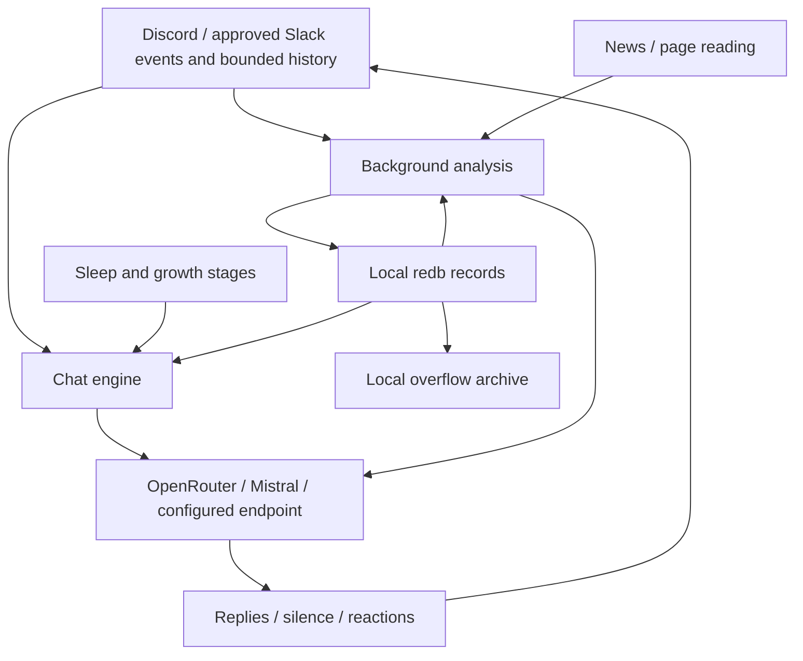

# Architecture

Platform events enter the chat engine through the shared v2-core boundary. Discord and Slack Socket Mode are enabled transports; configured connections can run simultaneously. Replies combine the core persona, evolving notes, retrieved memory, and the current task. Finished chats are queued for background memory analysis. This changes reply context, not model weights; there is no fixed 12-message conversation limit.

## Data boundaries

Selected messages, saved notes, and optionally images leave the host for model processing. Discord's first scan reads up to 14 days of accessible text history, subject to configured scope and permissions. Slack history is bounded, membership-sensitive and rate-limited; missing/blank `SLACK_CHANNELS` denies all learning. Observation continues while asleep. All connections share the brain: source-qualified IDs prevent collisions, not cross-channel information flow. Only trusted approved rooms should be included. Firecrawl receives URLs/search queries when configured. [Privacy and retention](setup-guide.md#privacy) and [Slack onboarding](setup-guide.md#slack-socket-mode) are deployment concerns, not properties supplied by redb.

## Source layout

| Entry point | Responsibility |
|---|---|
| `src/main.rs`, `src/bot/setup.rs` | process/configuration and startup |
| `src/bot/types/` | shared state and limits |
| `src/bot/handler/`, `src/bot/lifecycle.rs` | normalized events, approval, history and willingness decisions |
| `src/bot/chat/` | conversation turns and research |
| `src/bot/provider/` | requests, personality/analysis split, streaming and send paths |
| `src/bot/text/` | pure reply parsing and text helpers |
| `src/bot/cycle/` | background loops, memory queues and actions |
| `src/command.rs`, `src/command/` | shared typed actions, validation and administrative read models |
| `src/platform/discord/` | native gateway, SDK transport, slash registration, UI cards/modals and renderer |
| `src/platform/slack/` | Socket Mode runner, Web API transport, normalized event decoder and Slack-safe text renderer |
| `src/agents.rs`, `src/agenda.rs` | analysis and web/news work |
| `src/memory.rs`, `src/migrate.rs` | redb records, retrieval, summarization/archive support and legacy import |
| `src/growth.rs`, `src/sleep.rs`, `src/travel.rs` | growth stages, clock/sleep, Turkish calendar |
| `src/prompts.rs`, `src/strings.rs`, `src/lang.rs` | language dispatch; `BOT_LANG` defaults to `en`, fixed for the process |
| `src/chat_cli.rs`, `src/init.rs` | terminal bench and configuration wizard |

The grouped bot files compile through `include!` in the root module, and command files similarly share their parent scope. This preserves access to private items and macros without duplicating imports. The tradeoff is that a file boundary is not a Rust module boundary; find the aggregator before changing visibility or moving definitions. Detailed navigation: [modules](modules.md).

## State and concurrency

Serenity is vendored under `vendor/serenity` for planned in-tree changes; the Cargo registry patch keeps builds using that tree.

`Bot` owns a `Mutex<State>` and an HTTP client. State includes open chats, channel histories, memory context, sleep plans, queued observations and runtime flags. Take a short lock to snapshot inputs, drop it before network/model awaits, and take another short lock to apply results. **No state/cache lock crosses `.await`.** A per-channel RAII busy guard clears reply ownership on normal exit or unwinding.

Conversation uses route-aware `generate_for` / `generate_stream_for`, with the persona and evolving context; shared-brain `generate` remains for non-route work. Background extraction/evaluation uses `analyze` / `analyze_with`, without the conversational persona. Trusted prompt templates are rendered once before literal runtime instructions are passed to those methods. Image commentary is intentionally a talking path.

## Context and storage

A reply combines the fixed language-specific persona, growth stage, temperament, group profile, memory index, bounded retrieved person/topic/event records, agenda, current self-state, clock/travel context, corrections, mood, and task. Retrieval has a 6,000-character budget; the index and fixed profile context are additional. Model output is parsed as a bounded line protocol: text, silence, or Unicode reaction. [Protocol details](flows.md#output-protocol-every-reply-with-personality-goes-through-this).

`durum/hafiza.redb` stores markdown under path-like keys; schema v2 person/room
records use source-qualified domain identities, and topics retain slug keys.
Overflow archives in `durum/arsiv/` are real files for human inspection, not bot
retrieval. New canonical archive names are escaped; historical filenames and
contents are unchanged. See [state files](state-files.md).

## Background work

| Agent | When | Produces |
|---|---|---|
| profiler | first-join scan and awake 6h cycle | group profile (`profil.md`) |
| diarist | finished chats and queued observations | person/topic/event notes and self-state |
| coach | startup when temperament is missing, awake 6h cycle | temperament/interests (`huy.md`) |
| critic | finished chats | correction notes (`duzeltmeler.md`) |
| summarizer | record exceeds its limit | shorter record, raw overflow archive |
| news_agent | 6h cycle, with sleep-time stash | group-relevant news from Hacker News/configured RSS |
| wanderer | 4h cycle while awake | news opinions (`gundem.md`) |
| image_commenter | image-prank time | personality-aware image comment |
| mood | chat opens, then every 4 turns | transient chat mood |

Schedules can skip work while asleep/traveling. Growth thresholds are defined in `src/growth.rs`, not learned; name selection is gradual and depends on the established stage. Travel runs only for Turkish. All reply and analysis calls count toward provider usage.

## Platform boundary

`platform::types` owns opaque, case-sensitive, shared `Arc<str>` identities:
`UserKey`, `SpaceKey`, `RoomKey`, `MessageKey`, `ThreadKey`, and `EventKey`.
Durable identity contains the platform and native scope, never credentials or a
display name. `ConnectionId` identifies a configured session independently.
Typed constructors reversibly escape UTF-8 components, and parsers reject unsafe
or noncanonical representations. Slack timestamps stay text, Telegram room IDs
can remain negative, and the CLI bench uses `terminal:room:local:bench`.

`platform::discord::events` converts SDK/cache data into normalized users, rooms,
safe text, structured mentions/replies, attachments and enriched reactions before
personality decisions. Shared ingress types are `IncomingMessage`, `ReactionEvent`,
`ChatEvent`, and `EventEnvelope`; account identity is connection-local.
`ConversationKey` includes optional topic/thread scope for adapter routing.
Explicit native conversions remain inside Discord transport/UI boundaries.
Memory has completed its canonical schema-v2 cutover. Discord and Slack keep native
protocol details in their adapters, rather than leaking them into the shared engine.

Capabilities describe usable room permissions: ordinary-message visibility,
history/decryption, replies/threads, sending/reactions/edits/deletes/typing,
nickname scope, private results, rich UI, output count units/limits, edit cadence
and upload constraints. Unknown rooms use unavailable capabilities, not assumed
success. Discord retains a 1900-Unicode-scalar output budget.

Offline characterization tests preserve input exclusions, first MIME image/off
selection, safe content, welcome and reply-user mentions, custom emoji labels,
thought/stealth rendering, slash registration and private UI builder semantics.
They are not live Discord network probes. Persisted settings-button `kapali`
remains distinct from slash option `kapat`; existing Discord quirks are retained.

### Slack Socket Mode boundary

`src/platform/slack/runner.rs` opens Socket Mode with the separate app-level
`SLACK_APP_TOKEN` (`xapp-`, `connections:write`), acknowledges envelopes and routes
normalized events into shared ingress. Web API calls use `SLACK_BOT_TOKEN`
(`xoxb-`); authentication obtains the workspace/account identity. Both tokens are
required together. Installation permissions come from
[`slack-app-manifest.yml`](slack-app-manifest.yml), with channel events and no
direct-message subscriptions or slash commands.

`events.rs` preserves timestamps as text identities and converts timestamp
fractions to milliseconds without floating-point rounding. Slack users are
workspace-qualified (`slack:user:<team>:<user>`); rooms likewise include the team
and native channel. Structured mentions, thread/reply scope, edits/deletes,
member joins, reactions, and native file identities cross the boundary without
Slack SDK types or authenticated URLs. User display-name lookup can enrich ID
fallbacks without changing durable identity.

`transport.rs` makes thin JSON Web API requests with **`reqwest =0.12.28`** and
handles Slack API failures, HTTP rate limits and `Retry-After` as platform errors.
Socket Mode uses **`tokio-tungstenite =0.30.0`**, with
**`futures-util =0.3.34`** for stream/sink operations. Room membership and explicit
`SLACK_CHANNELS` approval bound collection. Short cache locks and the history
reservation gate are released before sleep/network awaits; the rate gate
reserves time, not ownership of a network request.
`SLACK_HISTORY_TIER` defaults to `internal` (at least one-second spacing,
at most 100 messages/page); `restricted` selects at least 60-second spacing
and at most 15 messages/page for commercial non-Marketplace apps. HTTP 429
`Retry-After` updates the gate in either mode; requests are not automatically
retried.

The deliberately narrow client avoids coupling the core to a broad Slack SDK's
types and dependency/API churn. The alternative evaluated was
[`slack-morphism 2.31.0`](https://docs.rs/slack-morphism/2.31.0/slack_morphism/).
Its optional integrations include axum/hyper and Socket Mode WebSocket support.
Those integrations are useful for
other deployments but unnecessary for this adapter. Pinning the direct
[`tokio-tungstenite 0.30.0`](https://docs.rs/tokio-tungstenite/0.30.0/tokio_tungstenite/)
dependency keeps upgrades deliberate. This is a
maintenance choice, not a claim that slack-morphism is broken or that either
client was live-verified.

Slack advertises no typing indicator or per-channel nickname capability and
does not mutate the account profile as a fallback. Known Unicode reactions map
to Slack emoji names; native custom names pass through, and unknown Unicode is
explicitly unsupported. Own-message edits/deletes, thread-aware output, bounded
history and authenticated native-file resolution use the shared transport
contract. `render.rs` keeps raw chunks within 3,900 Unicode scalars and splits
escaping expansion to a 4,000-scalar rendered target.

Text administration (`!status` / `@bot status`) enters `AdminService`; results
use recipient-only `chat.postEphemeral`, never public or DM fallback. Qualified
`OWNER_KEY` supplies owner policy. `IMAGE_ANALYSIS=off` prevents private-file
image analysis; enabling it permits selected image bytes to leave for the
configured model service.

Offline wizard tests cover Slack-only `.env` generation while retaining Discord
setup. A `serde_yaml` parsing test checks the manifest's exact bot scopes/events,
Socket Mode flag, and absence of slash commands/user scopes. Deliberately ignored
live tests run only with real Slack token environment variables and optional
`SLACK_TEST_CHANNEL`: `cargo test --locked slack:: -- --ignored`. Such a command
is not a live-verification claim; the integration owner's fake-token release
smoke verifies startup/failure handling separately.

### Fallible memory API

Administrative callers use `memory::read_result(rel: &str)
-> Result<Option<String>, BotError>` and
`memory::write_result(rel: &str, content: &str) -> Result<(), BotError>`.
Missing records return `Ok(None)`; database errors are never presented as empty
memory. Construct identity record keys with `platform::keys::person_record`
or `room_record`, and parse them through the matching canonical parsers.
`memory::init_result(path: &Path) -> Result<(), BotError>` obtains exclusive
ownership and completes the versioned identity migration before state loading.

The migration preserves body bytes and modification times, creates a consistent
v1 snapshot and manifest before cutover, rejects conflicting destinations, and
advances the schema with all identity moves in one write transaction. Unknown
legacy keys and malformed scan entries remain retained/unresolved. Completed
version checks are idempotent. Derived `INDEX.md` is regenerated after success.
Rollback is offline restoration with the old binary, not a reverse runtime alias.

### Outgoing transport and rendering

`platform::Platform` is `Send + Sync` and exposes account/connection metadata,
room-sensitive capabilities and synchronous renderer hooks plus native
return-position `impl Future + Send` operations: `send`, `edit`, `delete`,
`react`, `typing`, `set_nickname`, `fetch_history`, `list_rooms`, and
`resolve_media`. `Adapter` match-delegates to concrete implementations, producing
statically generated futures rather than boxed hot-path trait objects.
The Slack concrete variant has one boxed allocation per configured connection to
keep the `Adapter` enum compact; operations do not box or dynamically dispatch futures.

`OutgoingMessage<'a>` borrows text through `Cow`, carries structured default-deny
mention/reply policies, attachment sources and optional card/thought presentation.
SDK objects, native markup and interaction tokens remain adapter-private.
`MessageReceipt` contains connection/message/room identities, accepted text and
version; reconciliation skips identical edits and updates accepted state only on
success. Provisional cleanup, line ordering, failed-send bookkeeping, welcome
prefixes, reply-user pings and Discord thought formatting remain characterized.
Missing edit/delete capability buffers final output, missing typing omits only
the network indicator, and an unsupported targeted reaction becomes one plain
emoji; an opening-path reaction without a target is still dropped.

`parse_reply(text, OutputLimits)` caps four logical lines before physical
transport splitting. Discord retains its exact 1900-character split boundaries,
1200 ms edit cadence and non-streaming pacing. Other count units support UTF-16
and encoded bytes without breaking Unicode scalars. Actual adapters must provide
usable budgets (positive scalar limit, at least two UTF-16 units or four UTF-8
bytes); indivisible scalars are never discarded for impossible test budgets.

`ConnectionRegistry` registers concrete adapters, binds `RoomRef` routes and
returns shared handles before awaits. `snapshot() -> Vec<ConnectionSnapshot>`
provides connection status, account identity and room capabilities for local
administration. No SDK client is exposed in the snapshot. Credentials are not
durable identities, and duplicate bindings across connections are rejected.

### Shared typed administration

The crate-local `command::AdminService::new(&Bot)` executes
`execute(&Actor, &ActionTarget, ActionArgs) -> Result<ActionResult, ActionError>`
as a native async function, with no Serenity context or manufactured interaction.
`Actor::User(UserKey)` identifies a platform account; `Actor::LocalOperator`
denotes an already-authenticated local panel operator. The latter is an explicit
trust boundary, not a synthetic Discord owner account.

`ActionTarget` carries optional connection and normalized room metadata (including
space/thread). Shared-brain reads/settings can run without a room; conversational
actions require a usable route. `ActionArgs` represents all sixteen actions:
status, help, mind, settings, reset, news, problem, wander, prank, hack, agents,
wake, sleep, thinking, model and debug. Results are structured read models or
localized acknowledgments, separate from transport presentation.

One schema supplies stable ActionIds, localized names/descriptions, typed options,
defaults, bounds, choices and permission/defer rules. Discord builds its original
native registration from that schema and converts real slash/button events.
Slow work is acknowledged before awaiting the shared executor; responses retain
their private embeds, in-place setting updates and display-only modal behavior.
The explicit-prefix parser and plain renderer share that schema but do not enable
Discord text administration or publish private memory/thoughts as a fallback.

Legacy Discord administration permissions remain unchanged, with exact qualified
owner gating for model setters. Other connections deny administration until an
explicit qualified administrator set is supplied through
`ConnectionRegistry::set_admin_users`; token changes/reconnects preserve policy.
`authorize` compares full source-qualified identity, never numeric ID or name.

### Generic lifecycle and adapter registration

`platform::runtime::ConnectionConfig::Discord { connection: ConnectionId, token: String }`
is the current startup configuration; credentials remain runner-local. Startup
calls `platform::runtime::run(Arc<Bot>, Vec<ConnectionConfig>) -> Result<(), BotError>`.
Adding a concrete network means extending this configuration enum and `Adapter`,
implementing the complete `Platform` interface, and providing an adapter-local
runner accepting an `EventSender` and `ShutdownReceiver`. No generic brain code
should need an SDK import. The Discord gateway and event handler now live under
`platform::discord`, including intents, slash UI, safe-content decoding and HTTP
enrichment.

Before connection readiness, configure its source through
`ConnectionRegistry::configure(&ConnectionId, PlatformKind) -> PlatformResult<()>`.
Set `RoomPolicy::Approved(HashSet<RoomKey>)` and qualified administrators explicitly
for non-Discord connections. Discovery alone never grants access. On real readiness
call `Bot::register_adapter(Adapter) -> PlatformResult<Arc<Adapter>>`, register native
UI, then send `ChatEvent::ConnectionReady(UserRef)`. Reconnecting updates account
metadata but does not replace the primary brain identity or duplicate its six cycles.
`ConnectionClosed` and runner termination mark only that connection disconnected.
Configured/connecting/disconnected entries remain visible in the status snapshot.

`EventSender::channel(capacity) -> (EventSender, Receiver<EventEnvelope>)` and
`EventSender::send(EventEnvelope) -> PlatformResult<()>` provide bounded ingress
(runtime capacity 256). The envelope contains a credential-independent connection,
source-qualified EventKey, timestamp in milliseconds, and domain event. Native
message IDs must be reused on replay; synthetic lifecycle/reaction IDs must not
collapse distinct legitimate events. Deduplication precedes model/memory work and
retains 4096 recent connection-qualified event IDs. Lifecycle discovery is ordered;
message/reaction/member model work is independently spawned. SDK acknowledgment
and private command response handles stay native: command surfaces call the shared
AdminService directly rather than publish a private response through generic send.

`SpaceRef` retains adapter-supplied room order and preferred-room metadata.
`HistoryRequest` carries a cutoff, bounded limit and optional native cursor;
`HistoryPage` declares ordering, continuation and limitations. Discord keeps its
attempt-once marker before the fetch, fourteen-day cutoff, native text-channel
selection, empty/bot filtering and two-thousand-character retained history.
`HistoryInitializationPolicy::AfterSuccess` does not mark failed or unsupported
new-platform history initialized. History is sorted oldest-first and prepended
to concurrently received live text without discarding it.

All chat state, active replies, queues and outgoing routes use `ConversationKey`
(base RoomKey plus optional source-qualified ThreadKey); transport always resolves
an explicitly bound, ready route. A base room cannot belong to two connections,
including through different topics. Legacy Discord NEWS/DEBUG overrides and
native-command routes remain explicit exceptions to learning filters; there is
no arbitrary-room or disconnected default-Discord fallback. Core observations
retain captured account IDs, not identities reconstructed from display names or
model output. Duplicate display names receive transcript-local disambiguation;
historical unattributed text remains unattributed. New threaded history uses a
reversible canonical filename without rewriting old Discord history bodies.

`OWNER_KEY` accepts a canonical UserKey and takes precedence over legacy numeric
`OWNER_ID` (Discord only); an invalid explicit value never falls back. The panel's
typed settings registry should validate it through `UserKey::from_str`, expose
it as optional, and preserve the numeric compatibility input. Configuration,
memory and status APIs do not expose native SDK objects or credentials.

Localized platform fragments render the common prompts through `PromptContext`.
The Discord golden fixtures retain complete English/Turkish bytes. Other networks
receive honest platform labels, reaction capability and actual-history context;
they are never instructed to pretend to be Discord. One brain intentionally
shares memory across explicitly trusted rooms; registry approval is the trust
boundary, not an independent brain per tenant.

History text and its companion `kanal-kimlikleri/{canonical-room}.md` (including
the same optional `/threads/{canonical-thread}` suffix) are committed in one redb
transaction. Companion JSON stores aligned optional `UserRef` entries, not IDs
guessed from text; absent legacy metadata remains `None`. Loading preserves
captured local speaker labels and source identities across restart.

Runtime additionally limits concurrent ingress model jobs to 32. Its separate
64-slot lifecycle/control queue remains serviceable while the 256-slot message
queue applies backpressure; SDK native private-command acknowledgment is not
queued behind model work.
