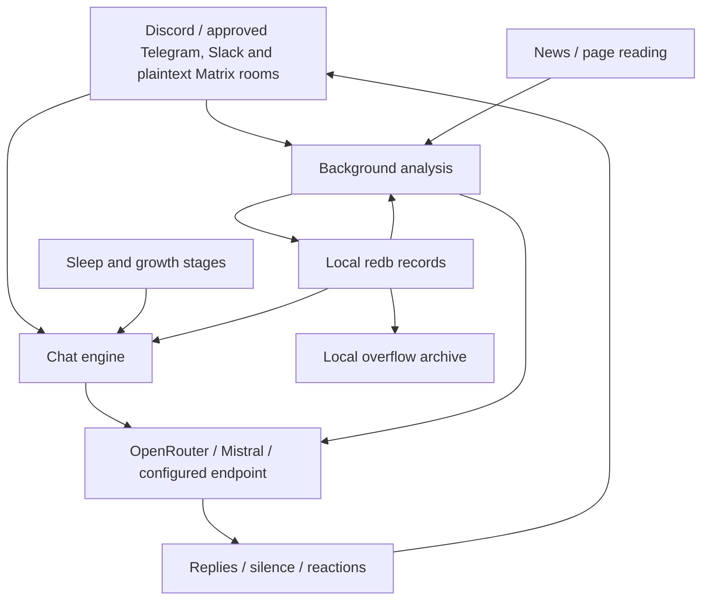

# Architecture

Platform events enter the chat engine through the shared platform boundary. Discord, Telegram, Slack Socket Mode and default-feature Matrix plaintext connections can run simultaneously. Replies combine the core persona, evolving notes, retrieved memory, and the current task. Finished chats are queued for background memory analysis. This changes reply context, not model weights; there is no fixed 12-message conversation limit.

## Data boundaries

Selected messages, saved notes, and optionally images leave the host for model processing. Discord's first scan reads up to 14 days of accessible text history, subject to configured scope and permissions. Telegram has no old group-history fetch and learns live updates plus locally retained text from explicitly approved rooms. Slack history is bounded, membership-sensitive and rate-limited; missing/blank `SLACK_CHANNELS` denies all learning. Observation continues while asleep. All connections share the brain: source-qualified IDs prevent collisions, not cross-channel information flow. Only trusted approved rooms should be included. Firecrawl receives URLs/search queries when configured. [Privacy and retention](setup-guide.md#privacy) and [Slack onboarding](setup-guide.md#slack-socket-mode) are deployment concerns, not properties supplied by redb.

## Embedded panel and startup

The single binary embeds an axum server, Askama templates, and local assets; there is no separate dashboard process or frontend build at runtime. The panel opens before bot credential validation. Missing credentials leave an unconfigured panel available rather than requiring a CLI wizard first. Both existing valid configuration and the completed setup wizard start the same transport-neutral runtime owner in-process.

When no administrator exists, startup exposes a one-use `/setup#token=...` console link valid for 15 minutes. Claiming it creates a temporary setup session; successfully setting an administrator password of at least 12 characters persists ownership before the remaining setup work. The five browser steps are claim/protect, choose one of Discord/Telegram/Slack/Matrix and test credentials, provider/model, language/timezone/access/news, and review/start. Telegram tests the BotFather-issued token with `getMe`, reports the bot identity and warns about privacy-limited ordinary group visibility. Slack tests the `xoxb-` bot token with `auth.test` and checks the `xapp-` app-level token using `apps.connections.open` and `connections:write`; this validates credentials and the returned WebSocket URL without opening a persistent Socket Mode connection. Matrix uses bearer-token `whoami` and checks the returned identity against `MATRIX_USER`; Matrix rooms are plaintext-only. These credential tests do not prove live room/gateway health, permissions, provider credit or successful conversation. Provider verification makes authenticated GET requests, not paid completions. First setup starts the runtime in-process without a process restart. Adding another platform later through Settings requires restart.

Setup completion writes configuration and signals the runtime owner through its bounded start channel. Normal headless startup uses `platform::runtime::run`; the panel owner uses the same supervisor through `run_with_shutdown`, forwarding its shutdown watch instead of constructing an SDK client. Lifecycle distinguishes unconfigured, configured/starting, running, configuration error, and stopping. Owned `ConnectionSnapshot` values report actual connection/account/room capabilities independently of panel availability; no Serenity cache/shard state is read by panel status. Moods belong to active conversations, not a global summary. Memory and temperament edits use the same durable revision coordinator as background learning. Actions dispatch the shared administration service; Usage reports process-local observations, not durable billing history.

Status JSON includes the unmodified `connections: Vec<ConnectionSnapshot>`, unique ready `rooms`/`spaces`, and localized `display.connections` details. Connecting and disconnected configurations remain distinguishable from ready accounts. Conversation rows use canonical room/thread/source identities rather than assuming Discord numeric channel IDs.

The interface uses system fonts and server-rendered forms with a visible, wrapping mobile navigation and a full-height sidebar background. An unconfigured Overview shows one setup invitation instead of unavailable runtime cards. Setup, sign-in, settings, account, memory edits, temperament edits, and action confirmations work without JavaScript; the console claim code can be pasted manually. JavaScript adds setup-fragment handling, passive status refreshes, native unsaved-prose navigation warnings, and live logs. The product name has one source, `views::PROJECT_NAME`, inserted through the shared localized brand pattern. Ordinary settings never receive secret-status labels; credential fields show only configured/source flags.

Responses use `Referrer-Policy: same-origin`: external destinations receive no referrer, while native same-origin form submissions retain a verifiable Origin header. `no-referrer` caused Chrome to submit `Origin: null`; null and cross-origin submissions remain rejected rather than weakening origin/CSRF validation.

### Memory and personality editing

The browser exposes only canonical People, safe Topics, and monthly Events, not arbitrary database paths or control/authentication tables. Searches and cursor pages cover the complete record collection, independently of retrieval-index limits. Person identities are immutable; favorite scores remain +10. Unknown or noncanonical person formats are read-only rather than silently dropping fields. Monthly events show both summary prose and raw dated lines.

The shared redb handle stores editable bodies, monotonic per-record revisions, and exact displaced snapshots. HTTP replacements require a strong `If-Match` ETag (428 if missing, 412 if stale); native forms submit the same revision precondition. Conflict screens keep the submitted draft beside the current text without automatically overwriting it. Previous material remains sensitive retained history, not member erasure.

Every editable writer enters a synchronous mutation gate without holding Bot state: apply latest-value deltas or snapshot CAS, derive `INDEX.md` from the same write transaction, commit/drop, then publish affected caches under a short state lock. Conflicting generated prose is discarded for a fresh later run; failed commits publish nothing. Summarizer originals remain durable in history independently of optional filesystem archive copies.

Personality separates the compiled `BOT_LANG` core, CAS-editable `huy.md`, read-only group profile/self-state/corrections/growth, and temporary per-conversation mood. A later coach run may evolve or replace manual temperament; edits do not pin learning or train model weights.

### Actions and observed usage

The Actions page uses all sixteen shared action definitions, canonical connection/room/thread discovery, explicit argument and side-effect review, and the authenticated `Actor::LocalOperator` boundary. Read-only controls navigate to their pages; mutations run bounded, session-idempotent jobs with real completion/failure and shutdown interruption. A queued job is not proof of delivery, and interruption cannot undo an already committed state change or already accepted external message.

Usage preserves missing versus explicitly reported zero token fields and separates cached input as a subset of input. Per-category observations include background agents where their existing accounting hooks run. Usage/token observations actually reported by a stream remain known even if that stream later fails. `counted_successful_calls` counts only decoded successful responses and fully drained streams; reporting counts may exceed successful counts, so they are not a ratio or billing denominator. Monetary cost, currency, and overall billing coverage stay **Not reported** when unavailable. There is no estimated price, spending enforcement, or persistent usage history.

### Configuration and settings

`src/config/` supplies the shared schema, validation, loading, and saving used by the panel, CLI, and bot. The startup process environment wins over the configured dotenv file; externally supplied fields are read-only in the panel. The default file is `.env`; Compose selects `/data/config/.env` with `PANEL_CONFIG_PATH`. Saves use a private atomic replacement while preserving unrelated settings/comments, so containers must mount a writable configuration **directory**, not just the file.

First setup starts the selected configured runtime without a process restart. Subsequent platform additions saved through Settings require a process restart; use `docker compose restart bot` or restart the binary from the same data folder. The separately stored `model.md` override still takes precedence over the configured model default. Stored secrets are not returned in settings fields; a blank secret input keeps the existing value. The file still holds plaintext API keys, not encrypted secrets. Telegram, Slack and Matrix room access is explicit/default-deny; credential tests are not proof of live connection, room access or message delivery.

Settings exposes four independent, initially collapsed platform credential-test forms before the provider test. Native and JSON endpoints require an explicit platform and reuse the wizard's shared protocol probes rather than separate HTTP clients. Only selected credential fields are normalized; nonblank supplied values override saved effective values for that request, while environment-managed values remain read-only. Testing a later addition before save/restart changes neither configuration nor wizard drafts. Matrix browser probes are access-token-only and leave saved runtime passwords untouched. These authenticated tests retain origin/CSRF, rate and concurrency guards and are not live-health checks.

Optional `OWNER_KEY` is a nonsecret canonical `UserKey`, validated by `UserKey::from_str` and presented in the Privacy settings group in both languages. Blank permits legacy numeric Discord `OWNER_ID`; a malformed explicit value rejects validation/save/startup instead of falling back. Active owner reads use the immutable shared configuration snapshot, including the wizard's first in-process runtime.

### Authentication and network boundary

The administrator's Argon2id password hash persists in the reserved `panel_admin` table in the **same `durum/hafiza.redb` database** used for memory. It is not a second redb handle/database. Ownership survives incomplete setup once the password has been saved; merely consuming the claim token does not persist an administrator. Sessions and credential drafts do not survive a process restart. Sessions use protected cookies, expiry, CSRF checks, and configured Host/Origin validation. A database error fails closed instead of exposing anonymous setup or creating empty replacement memory.

Panel startup calls the authoritative `memory::init_result` before authentication is exposed. Subsequent `Bot::setup` reuses that published handle instead of opening redb again. The versioned identity migration remains atomic; its consistent rollback snapshot preserves `panel_admin` ownership rows as well as memory/timestamps. Database/manifest files remain private, and auth table failures fail closed.

Local recovery is `discord-bot panel reset-password`, with the running bot stopped first and the same state directory mounted. It replaces the password with a random value printed once, invalidates sessions, and retains the owner and memory. State backups therefore include authentication data; deleting the database is not password recovery.

The default panel address is `http://localhost:8787`. Compose binds the container to `0.0.0.0` but publishes only `127.0.0.1:8787:8787`. Remote access should use a private SSH tunnel. An HTTPS proxy requires an explicit `PANEL_PUBLIC_URL` and matching Host/browser Origin; forwarded headers never determine authority. The [setup guide](setup-guide.md#accessing-a-remote-server) covers access and recovery.

Direct loopback access accepts only the fixed `localhost`, `127.0.0.1`, and `[::1]` aliases at the configured scheme and exact port; a mutation's browser Origin must match its request Host. Thus `curl http://127.0.0.1:8787/healthz` works without a Host override. Non-loopback proxy origins stay exact, and forwarded headers never expand this allowlist.

### Logs and persistence

Automatic log connections and reconnections authorize without refreshing the administrator's idle timeout, just like stream heartbeats and passive dashboard polling. Only actual page/form activity refreshes an idle session.

`src/logging.rs` provides a bounded, redacted recent-entry ring and authenticated panel streaming. The ring is in memory and disappears at restart; it is not a durable audit log or proof that exported logs contain no member data. Console/container logs are separate retention surfaces and may include the one-use claim link.

Compose mounts `./config` for private settings, `./photos` read-only, and the fixed named volume `discord-bot-data` at `/data/durum`. The Compose volume key remains `durum`; folder/project renaming no longer changes its identity. Multiple installations must deliberately use distinct volume names. Older project-prefixed volumes require an explicit stopped-service backup/restore migration; changing the name does not copy memory. [Migration instructions](setup-guide.md#existing-compose-installations) preserve the old volume rather than deleting it.

## Source layout

| Entry point | Responsibility |
|---|---|
| `src/main.rs`, `src/bot/setup.rs` | process/configuration and startup |
| `src/config/` | shared schema, environment/file precedence, validation and private atomic saves |
| `src/panel/` | embedded web lifecycle, setup, authentication, routes and rendered views |
| `src/logging.rs` | redacted bounded recent logs and panel stream source |
| `src/bot/types/` | shared state and limits |
| `src/bot/handler/`, `src/bot/lifecycle.rs` | normalized events, approval, history and willingness decisions |
| `src/bot/chat/` | conversation turns and research |
| `src/bot/provider/` | requests, personality/analysis split, streaming and send paths |
| `src/bot/text/` | pure reply parsing and text helpers |
| `src/bot/cycle/` | background loops, memory queues and actions |
| `src/command.rs`, `src/command/` | shared typed actions, validation and administrative read models |
| `src/platform/discord/` | native gateway, SDK transport, slash registration, UI cards/modals and renderer |
| `src/platform/telegram/` | thin Bot API client, long-poll runner, normalization, plain rendering and transport |
| `src/platform/slack/` | Socket Mode runner, Web API transport, normalized event decoder and Slack-safe text renderer |
| `src/platform/matrix/` | feature-gated plaintext SDK sync runner, raw-event decoder, native transport and plain renderer |
| `src/agents.rs`, `src/agenda.rs` | analysis and web/news work |
| `src/memory.rs`, `src/migrate.rs` | redb records, retrieval, summarization/archive support and legacy import |
| `src/growth.rs`, `src/sleep.rs`, `src/travel.rs` | growth stages, clock/sleep, Turkish calendar |
| `src/prompts.rs`, `src/strings.rs`, `src/lang.rs` | language dispatch; `BOT_LANG` defaults to `en`, fixed for the process |
| `src/chat_cli.rs`, `src/init.rs` | terminal bench and optional headless configuration wizard (interactive credentials hidden) |

The grouped bot files compile through `include!` in the root module, and command files similarly share their parent scope. This preserves access to private items and macros without duplicating imports. The tradeoff is that a file boundary is not a Rust module boundary; find the aggregator before changing visibility or moving definitions. Detailed navigation: [modules](modules.md).

## State and concurrency

Serenity is vendored under `vendor/serenity` for planned in-tree changes; the Cargo registry patch keeps builds using that tree.

`Bot` owns a `Mutex<State>` and an HTTP client. State includes open chats, channel histories, memory context, sleep plans, queued observations and runtime flags. Take a short lock to snapshot inputs, drop it before network/model awaits, and take another short lock to apply results. **No state/cache lock crosses `.await`.** A per-channel RAII busy guard clears reply ownership on normal exit or unwinding.

Conversation uses route-aware `generate_for` / `generate_stream_for`, with the persona and evolving context; shared-brain `generate` remains for non-route work. Background extraction/evaluation uses `analyze` / `analyze_with`, without the conversational persona. Trusted prompt templates are rendered once before literal runtime instructions are passed to those methods. Image commentary is intentionally a talking path.

## Context and storage

A reply combines the fixed language-specific persona, growth stage, temperament, group profile, memory index, bounded retrieved person/topic/event records, agenda, current self-state, clock/travel context, corrections, mood, and task. Retrieval has a 6,000-character budget; the index and fixed profile context are additional. Model output is parsed as a bounded line protocol: text, silence, or Unicode reaction. [Protocol details](flows.md#output-protocol-every-reply-with-personality-goes-through-this).

`durum/hafiza.redb` stores markdown under path-like keys; schema v2 person/room
records use source-qualified domain identities, and topics retain slug keys.
Overflow archives in `durum/arsiv/` are real files for human inspection, not bot
retrieval. New canonical archive names are escaped; historical filenames and
contents are unchanged. See [state files](state-files.md).

## Background work

| Agent | When | Produces |
|---|---|---|
| profiler | first-join scan and awake 6h cycle | group profile (`profil.md`) |
| diarist | finished chats and queued observations | person/topic/event notes and self-state |
| coach | startup when temperament is missing, awake 6h cycle | temperament/interests (`huy.md`) |
| critic | finished chats | correction notes (`duzeltmeler.md`) |
| summarizer | record exceeds its limit | shorter record, raw overflow archive |
| news_agent | 6h cycle, with sleep-time stash | group-relevant news from Hacker News/configured RSS |
| wanderer | 4h cycle while awake | news opinions (`gundem.md`) |
| image_commenter | image-prank time | personality-aware image comment |
| mood | chat opens, then every 4 turns | transient chat mood |

Schedules can skip work while asleep/traveling. Growth thresholds are defined in `src/growth.rs`, not learned; name selection is gradual and depends on the established stage. Travel runs only for Turkish. All reply and analysis calls count toward provider usage.

## Platform boundary

`platform::types` owns opaque, case-sensitive, shared `Arc<str>` identities:
`UserKey`, `SpaceKey`, `RoomKey`, `MessageKey`, `ThreadKey`, and `EventKey`.
Durable identity contains the platform and native scope, never credentials or a
display name. `ConnectionId` identifies a configured session independently.
Typed constructors reversibly escape UTF-8 components, and parsers reject unsafe
or noncanonical representations. Slack timestamps stay text, Telegram room IDs
can remain negative, and the CLI bench uses `terminal:room:local:bench`.

`platform::discord::events` converts SDK/cache data into normalized users, rooms,
safe text, structured mentions/replies, attachments and enriched reactions before
personality decisions. Shared ingress types are `IncomingMessage`, `ReactionEvent`,
`ChatEvent`, and `EventEnvelope`; account identity is connection-local.
`ConversationKey` includes optional topic/thread scope for adapter routing.
Explicit native conversions remain inside Discord transport/UI boundaries.
Memory has completed its canonical schema-v2 cutover. Discord, Telegram, Slack and
feature-gated Matrix keep native protocol details in their adapters; capabilities
do not advertise unsupported operations. Matrix does not claim decryption or
native rich UI.

Capabilities describe usable room permissions: ordinary-message visibility,
history/decryption, replies/threads, sending/reactions/edits/deletes/typing,
nickname scope, private results, rich UI, output count units/limits, edit cadence
and upload constraints. Unknown rooms use unavailable capabilities, not assumed
success. Discord retains a 1900-Unicode-scalar output budget.

`Capabilities.send_attachments` is independent of `upload_bytes`: the former
reports permission/support for the outgoing attachment kinds implemented by the
adapter, while the latter is an optional upload ceiling (`None` means unknown,
not unsupported). Unknown/unavailable routes set attachment sending to false.
Discord requires sending permission plus `ATTACH_FILES`; Telegram requires sending
permission plus native photo rights (or a direct/admin room); Slack additionally
requires `files:write`; plaintext Matrix uses `m.room.message` power levels.
Actual attachment types, size checks and transport failures remain adapter-local.

Offline characterization tests preserve input exclusions, first MIME image/off
selection, safe content, welcome and reply-user mentions, custom emoji labels,
thought/stealth rendering, slash registration and private UI builder semantics.
They are not live Discord network probes. Persisted settings-button `kapali`
remains distinct from slash option `kapat`; existing Discord quirks are retained.

### Slack Socket Mode boundary

`src/platform/slack/runner.rs` opens Socket Mode with the separate app-level
`SLACK_APP_TOKEN` (`xapp-`, `connections:write`), acknowledges envelopes and routes
normalized events into shared ingress. Web API calls use `SLACK_BOT_TOKEN`
(`xoxb-`); authentication obtains the workspace/account identity. Both tokens are
required together. Installation permissions come from
[`slack-app-manifest.yml`](slack-app-manifest.yml), with channel events and no
direct-message subscriptions or slash commands.

`events.rs` preserves timestamps as text identities and converts timestamp
fractions to milliseconds without floating-point rounding. Slack users are
workspace-qualified (`slack:user:<team>:<user>`); rooms likewise include the team
and native channel. Structured mentions, thread/reply scope, edits/deletes,
member joins, reactions, and native file identities cross the boundary without
Slack SDK types or authenticated URLs. User display-name lookup can enrich ID
fallbacks without changing durable identity.

`transport.rs` makes thin JSON Web API requests with **`reqwest =0.12.28`** and
handles Slack API failures, HTTP rate limits and `Retry-After` as platform errors.
Socket Mode uses **`tokio-tungstenite =0.30.0`**, with
**`futures-util =0.3.34`** for stream/sink operations. Room membership and explicit
`SLACK_CHANNELS` approval bound collection. Short cache locks and the history
reservation gate are released before sleep/network awaits; the rate gate
reserves time, not ownership of a network request.
`SLACK_HISTORY_TIER` defaults to `internal` (at least one-second spacing,
at most 100 messages/page); `restricted` selects at least 60-second spacing
and at most 15 messages/page for commercial non-Marketplace apps. HTTP 429
`Retry-After` updates the gate in either mode; requests are not automatically
retried.

The deliberately narrow client avoids coupling the core to a broad Slack SDK's
types and dependency/API churn. The alternative evaluated was
[`slack-morphism 2.31.0`](https://docs.rs/slack-morphism/2.31.0/slack_morphism/).
Its optional integrations include axum/hyper and Socket Mode WebSocket support.
Those integrations are useful for
other deployments but unnecessary for this adapter. Pinning the direct
[`tokio-tungstenite 0.30.0`](https://docs.rs/tokio-tungstenite/0.30.0/tokio_tungstenite/)
dependency keeps upgrades deliberate. This is a
maintenance choice, not a claim that slack-morphism is broken or that either
client was live-verified.

Slack advertises no typing indicator or per-channel nickname capability and
does not mutate the account profile as a fallback. Known Unicode reactions map
to Slack emoji names; native custom names pass through, and unknown Unicode is
explicitly unsupported. Own-message edits/deletes, thread-aware output, bounded
history and authenticated native-file resolution use the shared transport
contract. `render.rs` keeps raw chunks within 3,900 Unicode scalars and splits
escaping expansion to a 4,000-scalar rendered target.

Text administration (`!status` / `@bot status`) enters `AdminService`; results
use recipient-only `chat.postEphemeral`, never public or DM fallback. Qualified
`OWNER_KEY` supplies owner policy. `IMAGE_ANALYSIS=off` prevents private-file
image analysis; enabling it permits selected image bytes to leave for the
configured model service.

Offline wizard tests cover Slack-only `.env` generation while retaining Discord
setup. A `serde_yaml` parsing test checks the manifest's exact bot scopes/events,
Socket Mode flag, and absence of slash commands/user scopes. Deliberately ignored
live tests run only with real Slack token environment variables and optional
`SLACK_TEST_CHANNEL`: `cargo test --locked slack:: -- --ignored`. Such a command
is not a live-verification claim; the integration owner's fake-token release
smoke verifies startup/failure handling separately.

### Fallible memory API

Administrative callers use `memory::read_result(rel: &str)
-> Result<Option<String>, BotError>` and
`memory::write_result(rel: &str, content: &str) -> Result<(), BotError>`.
Missing records return `Ok(None)`; database errors are never presented as empty
memory. Construct identity record keys with `platform::keys::person_record`
or `room_record`, and parse them through the matching canonical parsers.
`memory::init_result(path: &Path) -> Result<(), BotError>` obtains exclusive
ownership and completes the versioned identity migration before state loading.

The migration preserves body bytes and modification times, creates a consistent
v1 snapshot and manifest before cutover, rejects conflicting destinations, and
advances the schema with all identity moves in one write transaction. Unknown
legacy keys and malformed scan entries remain retained/unresolved. Completed
version checks are idempotent. Derived `INDEX.md` is regenerated after success.
Rollback is offline restoration with the old binary, not a reverse runtime alias.

### Outgoing transport and rendering

`platform::Platform` is `Send + Sync` and exposes account/connection metadata,
room-sensitive capabilities and synchronous renderer hooks plus native
return-position `impl Future + Send` operations: `send`, `edit`, `delete`,
`react`, `typing`, `set_nickname`, `fetch_history`, `list_rooms`, and
`resolve_media`. `Adapter` match-delegates to concrete implementations, producing
statically generated futures rather than boxed hot-path trait objects.
The Slack concrete variant has one boxed allocation per configured connection to
keep the `Adapter` enum compact; operations do not box or dynamically dispatch futures.

`OutgoingMessage<'a>` borrows text through `Cow`, carries structured default-deny
mention/reply policies, attachment sources and optional card/thought presentation.
SDK objects, native markup and interaction tokens remain adapter-private.
`MessageReceipt` contains connection/message/room identities, accepted text and
version; reconciliation skips identical edits and updates accepted state only on
success. Provisional cleanup, line ordering, failed-send bookkeeping, welcome
prefixes, reply-user pings and Discord thought formatting remain characterized.
Missing edit/delete capability buffers final output, missing typing omits only
the network indicator, and an unsupported targeted reaction becomes one plain
emoji; an opening-path reaction without a target is still dropped.

`parse_reply(text, OutputLimits)` caps four logical lines before physical
transport splitting. Discord retains its exact 1900-character split boundaries,
1200 ms edit cadence and non-streaming pacing. Other count units support UTF-16
and encoded bytes without breaking Unicode scalars. Actual adapters must provide
usable budgets (positive scalar limit, at least two UTF-16 units or four UTF-8
bytes); indivisible scalars are never discarded for impossible test budgets.

`ConnectionRegistry` registers concrete adapters, binds `RoomRef` routes and
returns shared handles before awaits. `snapshot() -> Vec<ConnectionSnapshot>`
provides connection status, account identity and room capabilities for local
administration. No SDK client is exposed in the snapshot. Credentials are not
durable identities, and duplicate bindings across connections are rejected.

### Shared typed administration

The crate-local `command::AdminService::new(&Bot)` executes
`execute(&Actor, &ActionTarget, ActionArgs) -> Result<ActionResult, ActionError>`
as a native async function, with no Serenity context or manufactured interaction.
`Actor::User(UserKey)` identifies a platform account; `Actor::LocalOperator`
denotes an already-authenticated local panel operator. The latter is an explicit
trust boundary, not a synthetic Discord owner account.

The panel constructs `AdminService::new_owned(&Arc<Bot>)`. This offloads bounded synchronous reads and commit/publication closures to blocking workers while leaving provider/delivery futures normally awaited and cancellable. The borrowed native constructor keeps its existing scheduling boundary. `use_default_model(&Actor)` is a typed operation, not a magic model ID; it validates the configured default and removes the durable override before publication.

Action errors are localized without exposing provider/storage bodies. Delivery acknowledgments distinguish accepted public delivery from model silence, empty input/news, and unchanged sleep state. Resets reject busy generations instead of clearing flags owned by in-flight work. Cancellation restores unanswered wake mentions through RAII; a timeout cannot silently discard them.

`ActionTarget` carries optional connection and normalized room metadata (including
space/thread). Shared-brain reads/settings can run without a room; conversational
actions require a usable route. `ActionArgs` represents all sixteen actions:
status, help, mind, settings, reset, news, problem, wander, prank, hack, agents,
wake, sleep, thinking, model and debug. Results are structured read models or
localized acknowledgments, separate from transport presentation.

One schema supplies stable ActionIds, localized names/descriptions, typed options,
defaults, bounds, choices and permission/defer rules. Discord builds its original
native registration from that schema and converts real slash/button events.
Slow work is acknowledged before awaiting the shared executor; responses retain
their private embeds, in-place setting updates and display-only modal behavior.
The explicit-prefix parser and plain renderer share that schema but do not enable
Discord text administration or publish private memory/thoughts as a fallback.

Legacy Discord administration permissions remain unchanged, with exact qualified
owner gating for model setters. Other connections deny administration until an
explicit qualified administrator set is supplied through
`ConnectionRegistry::set_admin_users`; token changes/reconnects preserve policy.
`authorize` compares full source-qualified identity, never numeric ID or name.

### Generic lifecycle and adapter registration

`platform::runtime::ConnectionConfig` configures Discord with
`Discord { connection: ConnectionId, token: String }`, Telegram with
`Telegram { connection: ConnectionId, token: String, rooms: HashSet<RoomKey>,
owner: Option<UserKey> }`, Slack with
`Slack { connection: ConnectionId, app_token: String, bot_token: String }`, and
feature-gated Matrix with `Matrix { connection: ConnectionId, config: MatrixConfig }`.
`MatrixConfig` carries homeserver, native user, optional access token/password,
and explicit room approval. Credentials remain runner-local.
The common `configured_connections` selector reads the immutable active settings
for both headless startup and the panel's first runtime, allowing any configured
combination. Partial Slack or Matrix credentials fail validation rather than
being ignored. Configured Matrix in a minimal build reports the missing feature.
Startup calls `platform::runtime::run(Arc<Bot>, Vec<ConnectionConfig>) -> Result<(), BotError>`.
The panel forwards its `ShutdownReceiver` to `run_with_shutdown(Arc<Bot>, Vec<ConnectionConfig>, ShutdownReceiver)`; this owns the same adapter tasks/brain and does not expose native shard managers or caches. A cancellation already requested before startup prevents credential activation and SDK construction.
Adding a concrete network means extending this configuration enum and `Adapter`,
implementing the complete `Platform` interface, and providing an adapter-local
runner accepting an `EventSender` and `ShutdownReceiver`. No generic brain code
should need an SDK import. The Discord gateway and event handler live under
`platform::discord`, including intents, slash UI, safe-content decoding and HTTP
enrichment.

Before connection readiness, configure its source through
`ConnectionRegistry::configure(&ConnectionId, PlatformKind) -> PlatformResult<()>`.
Set `RoomPolicy::Approved(HashSet<RoomKey>)` and qualified administrators explicitly
for non-Discord connections. Discovery alone never grants access. On real readiness
call `Bot::register_adapter(Adapter) -> PlatformResult<Arc<Adapter>>`, register native
UI, then send `ChatEvent::ConnectionReady(UserRef)`. Reconnecting updates account
metadata but does not replace the primary brain identity or duplicate its six cycles.
`ConnectionClosed` and runner termination mark only that connection disconnected.
Configured/connecting/disconnected entries remain visible in the status snapshot.

`EventSender::channel(capacity) -> (EventSender, Receiver<EventEnvelope>)` and
`EventSender::send(EventEnvelope) -> PlatformResult<()>` provide bounded ingress
(runtime capacity 256). The envelope contains a credential-independent connection,
source-qualified EventKey, timestamp in milliseconds, and domain event. Native
message IDs must be reused on replay; synthetic lifecycle/reaction IDs must not
collapse distinct legitimate events. Deduplication precedes model/memory work and
retains 4096 recent connection-qualified event IDs. Lifecycle discovery is ordered;
message/reaction/member model work is independently spawned. SDK acknowledgment
and private command response handles stay native: command surfaces call the shared
AdminService directly rather than publish a private response through generic send.

`SpaceRef` retains adapter-supplied room order and preferred-room metadata.
`HistoryRequest` carries a cutoff, bounded limit and optional native cursor;
`HistoryPage` declares ordering, continuation and limitations. Discord keeps its
attempt-once marker before the fetch, fourteen-day cutoff, native text-channel
selection, empty/bot filtering and two-thousand-character retained history.
`HistoryInitializationPolicy::AfterSuccess` does not mark failed or unsupported
new-platform history initialized. History is sorted oldest-first and prepended
to concurrently received live text without discarding it.

All chat state, active replies, queues and outgoing routes use `ConversationKey`
(base RoomKey plus optional source-qualified ThreadKey); transport always resolves
an explicitly bound, ready route. A base room cannot belong to two connections,
including through different topics. Legacy Discord NEWS/DEBUG overrides and
native-command routes remain explicit exceptions to learning filters; there is
no arbitrary-room or disconnected default-Discord fallback. Core observations
retain captured account IDs, not identities reconstructed from display names or
model output. Duplicate display names receive transcript-local disambiguation;
historical unattributed text remains unattributed. New threaded history uses a
reversible canonical filename without rewriting old Discord history bodies.

`OWNER_KEY` accepts a canonical UserKey and takes precedence over legacy numeric
`OWNER_ID` (Discord only); an invalid explicit value never falls back. The panel's
typed settings registry should validate it through `UserKey::from_str`, expose
it as optional, and preserve the numeric compatibility input. Configuration,
memory and status APIs do not expose native SDK objects or credentials.

### Matrix plaintext adapter

Matrix uses `matrix-sdk` 0.19.1 under the default-enabled `matrix` Cargo feature
(removable with `--no-default-features`), with SDK crypto disabled. Its runner
logs in/restores a session, registers the concrete adapter,
and consumes raw sync JSON through an adapter-local decoder before publishing
normalized envelopes. Sync is outbound HTTP(S), with no inbound webhook listener.
Matrix user/room/event IDs remain opaque, case-sensitive native IDs inside their
canonical typed keys; `@owner:example.org` becomes
`matrix:user:%40owner%3Aexample.org`, not a display-name identity.

Room discovery is not approval. `MATRIX_ROOMS` supplies native explicit
allowlisted room IDs; invitations from the qualified owner can approve additional
rooms and persist that decision in `rooms.json`. Previously joined unapproved
rooms do not enter the shared brain. An encryption state event prevents a room
from becoming a usable plaintext route; encrypted events/attachments are not
decrypted or interpreted as plaintext. No SDK crypto store or recovery support
is present. Approved conversational rooms share memory rather than private,
per-room brains.

The native transport supports bounded room history (`/messages`, at most 100
events per page), replies but not Matrix thread routes, `m.reaction`, `m.replace`
edits, own-event redaction, typing, and per-room membership nicknames. Sending/
reaction/edit/delete capabilities follow room power levels on sync; unknown and
encrypted rooms fail closed. Explicit `m.mentions` lists use `room:false`.
Authenticated homeserver MXC downloads are streamed with a 10 MiB bound and
JPEG/PNG/GIF/WebP MIME support; `IMAGE_ANALYSIS=off` bypasses image reading.
Local file/byte uploads are bounded at 10 MiB with one attachment per event.
Output uses a 16,000-UTF-8-byte budget and 1,200 ms edit cadence, not Discord's
scalar count. Decryption and native rich UI remain unavailable.

Matrix exposes owner-only `!status`, `!help` and the shared localized prefix
command schema, not Discord slash registrations, buttons or modals. Private
administrative results never fall back to public text. The runner creates a
dedicated private plaintext admin room and invites the owner when needed; it
persists that route in `admin-room.json`, checks that only bot/owner are joined
or invited, and rejects encryption. The owner must accept the invitation.
This route is excluded from conversational learning. Plaintext membership checks
are not E2EE: the homeserver can read the admin room too. An unusable private
route yields a privacy/error response, never public mind/settings detail.
`STEALTH` consumes commands without sending command UI.

Session/device identity and sync continuation are persisted under
`matrix/<connection>/session.json` and `sync.json`; SDK SQLite state is under
`matrix/<connection>/store/`. These live beneath the state directory, separately
from redb, and include secrets/cache data. Keeping them across restart preserves
device identity. [State protection](state-files.md#matrix-session-and-sync-state).
Offline decoder/renderer characterization is distinct from the opt-in ignored
`matrix_live` network tests documented in [configuration](configuration.md#disposable-matrix-integration-test).

Localized platform fragments render the common prompts through `PromptContext`.
The Discord golden fixtures retain complete English/Turkish bytes. Other networks
receive honest platform labels, reaction capability and actual-history context;
they are never instructed to pretend to be Discord. One brain intentionally
shares memory across explicitly trusted rooms; registry approval is the trust
boundary, not an independent brain per tenant.

History text and its companion `kanal-kimlikleri/{canonical-room}.md` (including
the same optional `/threads/{canonical-thread}` suffix) are committed in one redb
transaction. Companion JSON stores aligned optional `UserRef` entries, not IDs
guessed from text; absent legacy metadata remains `None`. Loading preserves
captured local speaker labels and source identities across restart.

Runtime additionally limits concurrent ingress model jobs to 32. Its separate
64-slot lifecycle/control queue remains serviceable while the 256-slot message
queue applies backpressure; SDK native private-command acknowledgment is not
queued behind model work.

### Telegram adapter contract

Telegram uses the existing reqwest 0.12 client family, not an SDK dispatcher or a
second brain. Outbound HTTPS `getUpdates` long polling is NAT-friendly; webhook
delivery and multiple pollers for one token are incompatible with this runner.
`getMe` establishes the connection-local bot account. Durable user/room keys use
`PlatformKind::Telegram` and native numeric components; message/thread identities
include their native chat scope. Native negative group IDs remain negative.

`TELEGRAM_ROOMS` explicitly approves rooms and defaults to deny all; membership
and discovery never grant access. `OWNER_KEY=telegram:user:<id>` supplies a
qualified administrator, independently of approval. Incoming ordinary group
visibility requires disabled privacy (remove/re-add after `/setprivacy` →
Disable) or group-administrator status. Reaction updates require administrator
status and explicit update subscriptions. Administrative results stay private;
users must first start the bot's private chat.

The adapter reports no remote group history and no per-group nickname operation.
History context is live/local only, not a fabricated fourteen-day scan. Plain
messages have a 4096-Unicode-scalar output budget; topic/reply IDs remain
transport-local. Reactions are restricted to chat-allowed emoji, never arbitrary
Unicode, paid reactions or custom emoji. Unsupported capabilities remain honest
rather than silently claiming success.

Media references retain Telegram file IDs, not token-bearing download URLs.
`getFile` resolves enabled images to a validated Telegram download; image-off
skips that network work. Local outgoing attachments use multipart upload, not
arbitrary remote URLs or path disclosure. Tokens are neither identity components
nor model/log/storage content. The next-update cursor lives in redb's
`memory_metadata` table under `platform/telegram/<bot-account-id>/offset`,
separate from conversation records. It checkpoints accepted ingress/queued
commands, not completed model work; crash replay/in-flight windows are not
exactly-once delivery. Telegram's pending queue is not history and expires after
at most 24 hours.

Offline fixtures/identity checks need no token; a separate fake-token startup
smoke contacts Telegram and is not offline or a successful authentication claim.
The ignored
`telegram_live_get_me` test is an explicit authenticated probe, not evidence of
group delivery or model behavior. Current sources checked 11 October 2026:
[Bot API](https://core.telegram.org/bots/api), [privacy mode](https://core.telegram.org/bots/features#privacy-mode),
[teloxide 0.17.0](https://crates.io/crates/teloxide),
[reqwest 0.13.5 / 0.12.28](https://crates.io/crates/reqwest).
The newest reqwest major is not required for these HTTP endpoints; retaining the
existing 0.12 dependency avoids unrelated transport/dependency migration.

