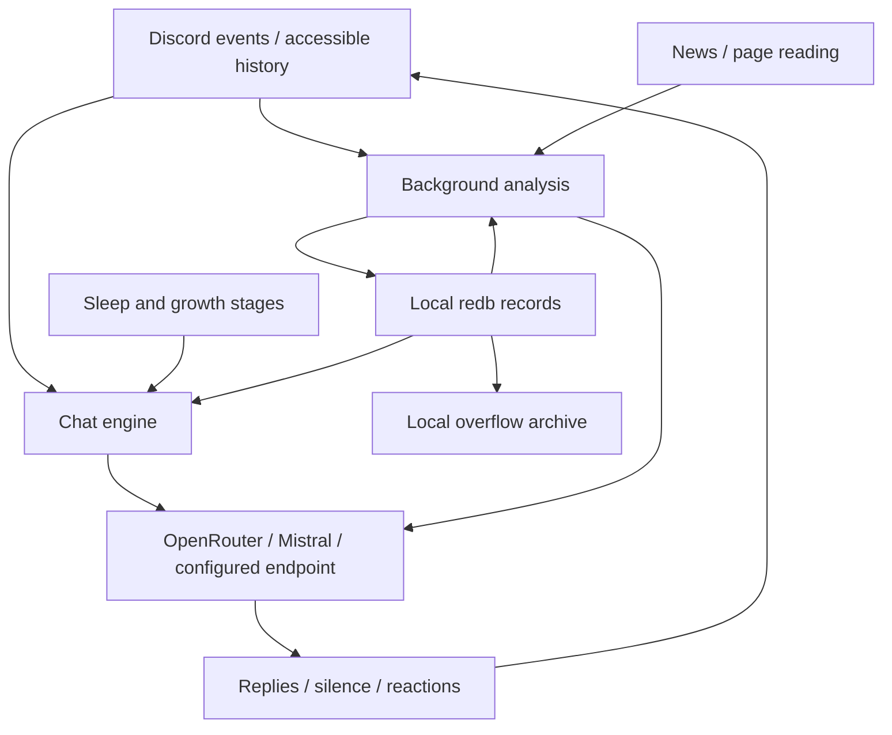

# Architecture

Discord events enter the chat engine. Replies combine the core persona, evolving notes, retrieved memory, and the current task. Finished chats are queued for background memory analysis. This changes reply context, not model weights; there is no fixed 12-message conversation limit.

## Data boundaries

Selected messages, saved notes, and optionally images leave the host for model processing. A first scan reads up to 14 days of accessible text history, subject to configured scope and permissions. Observation continues while asleep. Firecrawl receives URLs/search queries when configured. [Privacy and retention](setup-guide.md#privacy) are deployment concerns, not properties supplied by redb.

## Embedded panel and startup

The single binary embeds an axum server, Askama templates, and local assets; there is no separate dashboard process or frontend build at runtime. The panel opens before Discord credential validation. Missing bot credentials leave an unconfigured panel available rather than requiring a CLI wizard first. An existing valid configuration starts the Discord runtime alongside it.

When no administrator exists, startup exposes a one-use `/setup#token=...` console link valid for 15 minutes. Claiming it creates a temporary setup session; successfully setting an administrator password of at least 12 characters persists ownership before the remaining setup work. The five steps are claim/protect, Discord, provider/model, language/timezone/access/news, and invite/start. Discord verification uses its authenticated application API; the invite uses that verified application ID and permission mask `67226688`. Provider verification makes authenticated GET requests only, not paid completions. Neither test proves gateway health, model reply compatibility, or available credit.

Setup completion writes configuration and signals the runtime owner to start Discord within the same process. The lifecycle distinguishes unconfigured, configured/starting, running, configuration error, and stopping. Overview reports gateway connection separately from panel availability; moods belong to active conversations, not a global summary. It also shows process-local model-call/token counters, not provider cost accounting or durable usage history. Memory/personality editors, runtime action buttons, and the dedicated usage page are intentionally disabled pending core APIs.

### Configuration and settings

`src/config/` supplies the shared schema, validation, loading, and saving used by the panel, CLI, and bot. The startup process environment wins over the configured dotenv file; externally supplied fields are read-only in the panel. The default file is `.env`; Compose selects `/data/config/.env` with `PANEL_CONFIG_PATH`. Saves use a private atomic replacement while preserving unrelated settings/comments, so containers must mount a writable configuration **directory**, not just the file.

Initial setup starts Discord without a process restart. Subsequent Settings saves are restart-required, not live mutation: use `docker compose restart bot` or restart the binary from the same data folder. The separately stored `model.md` override still takes precedence over the configured model default. Stored secrets are not returned in settings fields; a blank secret input keeps the existing value. The file still holds plaintext API keys, not encrypted secrets.

### Authentication and network boundary

The administrator's Argon2id password hash persists in the reserved `panel_admin` table in the **same `durum/hafiza.redb` database** used for memory. It is not a second redb handle/database. Ownership survives incomplete setup once the password has been saved; merely consuming the claim token does not persist an administrator. Sessions and credential drafts do not survive a process restart. Sessions use protected cookies, expiry, CSRF checks, and configured Host/Origin validation. A database error fails closed instead of exposing anonymous setup or creating empty replacement memory.

Local recovery is `discord-bot panel reset-password`, with the running bot stopped first and the same state directory mounted. It replaces the password with a random value printed once, invalidates sessions, and retains the owner and memory. State backups therefore include authentication data; deleting the database is not password recovery.

The default panel address is `http://localhost:8787`. Compose binds the container to `0.0.0.0` but publishes only `127.0.0.1:8787:8787`. Remote access should use a private SSH tunnel. An HTTPS proxy requires an explicit `PANEL_PUBLIC_URL` and matching Host/browser Origin; forwarded headers never determine authority. The [setup guide](setup-guide.md#accessing-a-remote-server) covers access and recovery.

### Logs and persistence

`src/logging.rs` provides a bounded, redacted recent-entry ring and authenticated panel streaming. The ring is in memory and disappears at restart; it is not a durable audit log or proof that exported logs contain no member data. Console/container logs are separate retention surfaces and may include the one-use claim link.

Compose mounts `./config` for private settings, `./photos` read-only, and the fixed named volume `discord-bot-data` at `/data/durum`. The Compose volume key remains `durum`; folder/project renaming no longer changes its identity. Multiple installations must deliberately use distinct volume names. Older project-prefixed volumes require an explicit stopped-service backup/restore migration; changing the name does not copy memory. [Migration instructions](setup-guide.md#existing-compose-installations) preserve the old volume rather than deleting it.

## Source layout

| Entry point | Responsibility |
|---|---|
| `src/main.rs`, `src/bot/setup.rs` | process/configuration and startup |
| `src/config/` | shared schema, environment/file precedence, validation and private atomic saves |
| `src/panel/` | embedded web lifecycle, setup, authentication, routes and rendered views |
| `src/logging.rs` | redacted bounded recent logs and panel stream source |
| `src/bot/types/` | shared state and limits |
| `src/bot/handler/` | Discord events, scope filters, willingness decisions |
| `src/bot/chat/` | conversation turns and research |
| `src/bot/provider/` | requests, personality/analysis split, streaming and send paths |
| `src/bot/text/` | pure reply parsing and text helpers |
| `src/bot/cycle/` | background loops, memory queues and actions |
| `src/command.rs`, `src/command/`, `src/modal.rs` | slash registration, handlers and UI cards |
| `src/agents.rs`, `src/agenda.rs` | analysis and web/news work |
| `src/memory.rs`, `src/migrate.rs` | redb records, retrieval, summarization/archive support and legacy import |
| `src/growth.rs`, `src/sleep.rs`, `src/travel.rs` | growth stages, clock/sleep, Turkish calendar |
| `src/prompts.rs`, `src/strings.rs`, `src/lang.rs` | language dispatch; `BOT_LANG` defaults to `en`, fixed for the process |
| `src/chat_cli.rs`, `src/init.rs` | terminal bench and optional headless configuration wizard (interactive credentials hidden) |

The grouped bot files compile through `include!` in the root module, and command files similarly share their parent scope. This preserves access to private items and macros without duplicating imports. The tradeoff is that a file boundary is not a Rust module boundary; find the aggregator before changing visibility or moving definitions. Detailed navigation: [modules](modules.md).

## State and concurrency

Serenity is vendored under `vendor/serenity` for planned in-tree changes; the Cargo registry patch keeps builds using that tree.

`Bot` owns a `Mutex<State>` and an HTTP client. State includes open chats, channel histories, memory context, sleep plans, queued observations and runtime flags. Take a short lock to snapshot inputs, drop it before network/model awaits, and take another short lock to apply results. **No state/cache lock crosses `.await`.** A per-channel RAII busy guard clears reply ownership on normal exit or unwinding.

Conversation uses `generate` / `generate_stream`, with the persona and evolving context. Background extraction/evaluation uses `analyze`, without the conversational persona. Image commentary is intentionally a talking path.

## Context and storage

A reply combines the fixed language-specific persona, growth stage, temperament, group profile, memory index, bounded retrieved person/topic/event records, agenda, current self-state, clock/travel context, corrections, mood, and task. Retrieval has a 6,000-character budget; the index and fixed profile context are additional. Model output is parsed as a bounded line protocol: text, silence, or Unicode reaction. [Protocol details](flows.md#output-protocol-every-reply-with-personality-goes-through-this).

`durum/hafiza.redb` stores text under path-like keys; person keys use Discord user IDs, topic keys use slugs. Overflow archives in `durum/arsiv/` are real files for human inspection, not bot retrieval. Channel history is bounded separately. See [state files](state-files.md).

## Background work

| Agent | When | Produces |
|---|---|---|
| profiler | first-join scan and awake 6h cycle | group profile (`profil.md`) |
| diarist | finished chats and queued observations | person/topic/event notes and self-state |
| coach | startup when temperament is missing, awake 6h cycle | temperament/interests (`huy.md`) |
| critic | finished chats | correction notes (`duzeltmeler.md`) |
| summarizer | record exceeds its limit | shorter record, raw overflow archive |
| news_agent | 6h cycle, with sleep-time stash | group-relevant news from Hacker News/configured RSS |
| wanderer | 4h cycle while awake | news opinions (`gundem.md`) |
| image_commenter | image-prank time | personality-aware image comment |
| mood | chat opens, then every 4 turns | transient chat mood |

Schedules can skip work while asleep/traveling. Growth thresholds are defined in `src/growth.rs`, not learned; name selection is gradual and depends on the established stage. Travel runs only for Turkish. All reply and analysis calls count toward provider usage.
